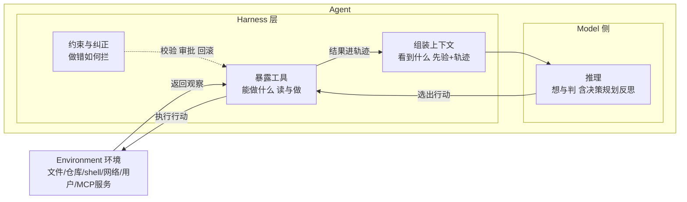
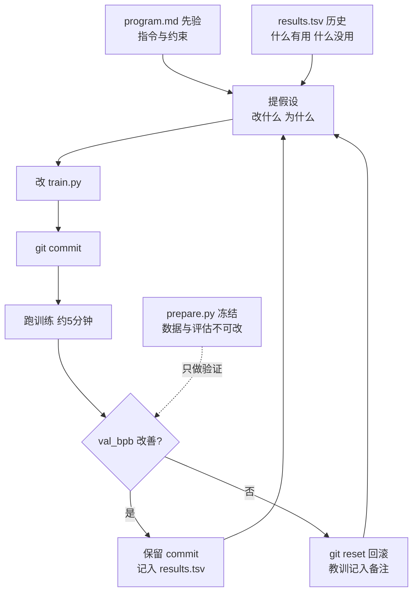
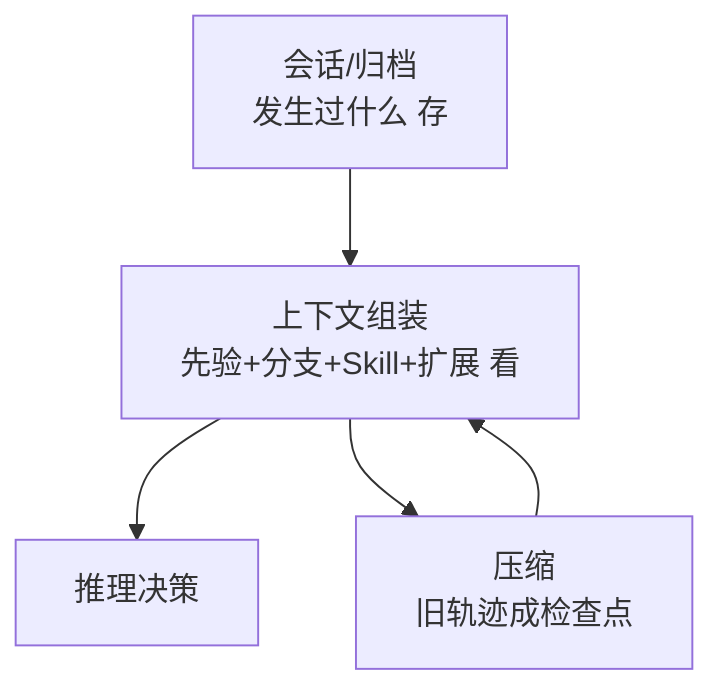

# 智能体笔记

**摘要：** 本文从自主智能体与环境闭环交互讲起：环境给观察，智能体做推理、选行动，行动再改变环境。智能体分两层——**Model 侧只有一件事：推理**（由 LLM 实现，想与判）；**Harness 侧有三件职责：组装上下文**（决策时能看到什么）、**暴露工具**（允许读什么、做什么）、**约束与纠正**（做错了如何拦）。第2节讲推理：先给定义与推理作用，再讲测试时扩展（解码＋自一致性＋五法表），最后讲模型侧训练扩展如何内化；第3、4节同属 Harness 层——第3节讲上下文（含记忆与搜索），第4节分原理、设计原则、生态、约束四节讲工具；第5节以 Karpathy autoresearch 为主案例、用一条真实研究循环串起三者，并以多库对照与四切面评估收尾。

**关键词：** LLM Agent；推理与规划；上下文窗口；工具调用；Harness；MCP；Agent Skills；Pi Agent；autoresearch

---

## 1 概述

自主智能体的顶层事实只有一条：**智能体与环境闭环交互**。环境返回观察，智能体基于当前信息做推理、选出下一步行动，行动改变环境，再产生新的观察，如此往复。

智能体内部只做两件事，用一句话说完：**模型负责想，Harness 负责给**。Model 侧只有推理——理解意图、拆解任务、选择工具、综合结果、失败反思都属于推理，由 LLM 实现，形态最广。Harness 侧有三件职责：**组装上下文**（本步决策用的信息状态，等于先验〔系统提示、项目指令、Skill 索引〕加上历史〔过去的观察与自己过去的输出〕）、**暴露工具**（智能体与世界的接口，规定了合法的读与做）、**约束与纠正**（校验、审批、沙箱、回滚）。

换句话说，本文第 3 节与第 4 节是同一个 Harness 层的两个面：**上下文回答"看到什么"，工具回答"能做什么"**，而约束与纠正保证前两者不失控。循环代码（组装→调模型→校验执行→回填）只是把这套交互落成程序，层次低于交互本身。



**图1 Agent–Environment 闭环：Model 负责想，Harness 负责给**

三个易混概念在这里一次分清：

1. **会话 ≠ 上下文 ≠ 观察。** 会话记录发生过什么（完整账本）；观察是环境单步返回的结果；上下文是本步推理用的信息，其中历史 = 观察历史 + 模型自己的输出（含 reasoning 与 tool_calls）。
2. **Memory 是存，上下文是看。** 会话树、压缩归档、AGENTS.md、Skill 库解决跨步保留；上下文组装解决本步给模型看什么。存看分离是第3节的论点，完整例证见第5节 Pi 解剖。
3. **规划是推理的一种，不单列。** 内部推理（CoT/分支搜索/反思）与落在上下文里的显式计划（如 todo、plan 文件、program.md）都是推理。第2节讲前者，第5节讲后者如何进轨迹。

最后一句总纲：本文是**静态版**——Model 与 Harness 各是什么；配套的《RSI 笔记》是**动态版**——它们如何随时间变强。两篇骨架逐节对齐，可对照阅读：

| 本文（静态：是什么） | RSI 笔记（动态：如何变强） |
| --- | --- |
| §2 推理 | §1 推理层如何变强 |
| §3 上下文 | §2.1 上下文如何变强 |
| §4 工具与约束 | §2.2–2.5 工具与约束如何变强 |
| §5 案例 | §3 案例 |
| §6 结论 | §4 结论 |

---

## 2 推理

**本节问题：** 定义→推理作用→测试时扩展→模型训练。聚合数字、Gemini 2025 等多为讲座独有，搜索见 3.3。

**推理 = 输入与最终答案之间的中间 tokens。** 定义沿用 Denny Zhou Stanford CS25 V5（Google DeepMind）讲座：高亮的逐步过程即推理，不争论“像不像人”，只看中间 token 是否承担计算。

> 参考：Denny Zhou《Large Language Model Reasoning》Stanford CS25 V5 视频 [Zhou-CS25-Video]、讲稿 slides [Zhou-CS25-Slides]、课程页 [CS25-V5]；Lilian Weng《Why We Think》[Weng-Think] 与其 Agent 综述 [Weng-Agent]。CoT-Decoding 论文版见 [CoTDecode]。

### 2.1 推理作用

1. **算力观（Weng）：** Transformer 每生成一个 token 的计算量约为 2 倍参数量，一次前向的算力是固定的。测试时扩展即提示让 z 变长：中间 token 既是草稿纸，也是按难度自适应的算力分配（难题多想、易题少想）。

2. **表达观（Zhou 讲座理论）：** 对可由规模 T 布尔电路解决的问题，固定规模 Transformer 生成 O(T) 中间 token 即可完成计算；直接出答案则需极大深度或不可能。中间 token 是工作区，不只是解释文字。

   LLM 一次前向只预测下一个 token，没有持久工作区，长任务一步错步步错；内部知识静态，缺事实就编；生成不可撤销，从左到右无法回溯。所以推理改进的基本手法只有两类：**把隐式思考外化为显式中间 token**（多占计算、供后文引用），以及**用环境反馈校准**（把观察拉回上下文）。

### 2.2 测试时扩展

设 z 为推理路径、y 为最终答案，则 `P(y|x)=sum_z P(y,z|x)`。greedy 取 `argmax_{y,z}`，想要的是 `argmax_y`，不一致才要边缘化 [Zhou-CS25-Video][Weng-Think]。

#### 2.2.1 解码

预训练模型 greedy 常直接答错（如讲座苹果题），因默认只取首 token 最高概率。CoT-Decoding [CoTDecode]：首 token 取 top-k 分支再 greedy 续写，选 final-token 置信最高的——推理路径本来就在输出空间，带推理的正确答案置信常跃升（讲座例近 98%），可做幻觉初筛。无推理时看 logits 即可，有推理才需聚合。

#### 2.2.2 自一致性

多次采样取众数即近似 `sum_z`，不看推理过程只看最终答案 [SelfConsistency]。GSM8K：微调 GPT-3 33%→验证器 55%→CoT 58%→SC 75%，PaLM 2＋SC 92%。长答案票散用 Universal SC 让模型选最一致者。谈 inference-scaling 须说清 scale 什么：CoT 长度 / 采样数 / 搜索范围，不等于扩参数；一致性越高准确率越高，可做校准信号。

| 方法           | 补什么毛病                 | 做法                                                                                                        | 测试时算力形态              | 讲座归类                                      | 出处                             |
| -------------- | -------------------------- | ----------------------------------------------------------------------------------------------------------- |:---------------------------:| --------------------------------------------- | -------------------------------- |
| CoT            | 直接答，多步任务上不去     | prompt 从`<输入, 输出>`改为`<输入, 推理链, 输出>`，答案前逐步输出自然语言推理                               | 串行：单链多占计算步        | 提示改变分布                                  | https://arxiv.org/abs/2201.11903 |
| ReAct          | 纯内部推理知识静态、易幻觉 | Thought 只更新上下文，Action 把工具结果（Observation）拉回上下文再想；最小循环“想→做→看”                    | 串行 + 外部反馈（工具结果） | 提示 + 搜索接地                               | https://arxiv.org/abs/2210.03629 |
| ToT            | 单链无法回溯               | 固定思考粒度 + 每步采样多分支 + 模型自评打分 + 搜索回溯；24 点任务报告 4%→74%（GPT-4 设置，见原论文实验节） | 并行分支 + 搜索剪枝         | 解码搜索历史方案：强思考模型下多被长 CoT 取代 | https://arxiv.org/abs/2305.10601 |
| Plan-and-Solve | 长任务漏步                 | 强制先列提纲再执行，把计划本身写进上下文                                                                    | 串行：先规划后执行          | 提示改变分布                                  | https://arxiv.org/abs/2305.04091 |
| Reflexion      | 错了还犯                   | Actor + Evaluator + 反思三循环，失败蒸馏成自然语言经验，下轮经上下文复用，不改参数                          | 跨轮串行修正 + 外部评估反馈 | 聚合前串行修正                                | https://arxiv.org/abs/2303.11366 |

一句话：CoT 加算力，ReAct 加事实，ToT 加回溯，提纲加结构，反思加跨轮经验。全部改进最终都体现为**下一次推理时的上下文变了**。

### 2.3 模型训练

内化的对象是**决策策略**——何时想、想多深、何时调哪个工具、如何回溯纠错；不是执行本身，工具仍在模型外跑。测试时方法不改参数只改用法，后训练把高频有效的用法蒸进参数；模型每内化一层，Harness 就卸下一层——Weng Harness 2026 的同款判断：prompt 技巧会被内化，但目标/约束/评测不消失 [Weng26]；STOP 的教训是底座须足够强，否则递归改不动。

脉络即讲座第一原则 `optimize what you want` 的展开：先定义想要的奖励 R（数学正确性 / BLEU / 单测通过），目标 `J(θ)=E[R]`，为算期望必须采样，再算梯度反传。人标 SFT 直接最大化人写 z 的似然，但分布远、难泛化，范式错则 scale 也没用。于是改让模型自产 z、按 R 留对弃错：STaR 留对再训、全错时拿答案倒推启动 [STaR]，拒绝采样回炉提纯，规则奖励 RL 只奖格式+答案/单测，DAPO 保长链稳定——R1 即此链的工程版（冷启动定格式→规则 RL→拒绝采样→全任务 RL，涌现 aha 回溯；PRM 定步难、易 hack，MCTS 在 token 级搜不动，故退回规则奖励）[R1]。前提只有两个：可靠 verifier，只 scale CoT 长度；不可验证任务不成立。

## 3 上下文（Harness 层 · 模型看到什么）

自注意力 `n²` 使窗口越大计算显存越贵，且任务一长即出现 context rot（有效利用远小于标称上限）。上下文核心是如何将信息进行分层，给模型的上下文如何拼高信号子集。参考 https://arxiv.org/abs/2310.08560

### 3.1 上下文结构

KV Cache 直接塑造了这种分层该怎么拼：推理时已算过的前缀键值可复用，追加新 token 只算增量——于是“静态前缀放最前、长期不变，轨迹只追加、不改中间”成了最优结构：system + 工具 schema 常驻复用，跨轮省掉重复计算；Skill 命中、扩展注入等动态内容放末尾，避免破坏前缀命中。做上下文设计时，原则只有一条：把高频稳定的放前面，把一次性的放后面。

每次调模型时的上下文由五部分构成，前两项静态、后三项随交互增长：

- **静态前缀：** 系统提示词（含身份、权限、行为准则）+ 工具定义（含名称、描述、参数 schema）。缺工具定义时模型不会停，会照样编答案——“给出回答≠完成任务”。
- **轨迹（动态历史）：** 用户消息 + 模型回复（含 reasoning、content、tool_calls）+ 工具执行结果。其中 reasoning 记“为何这么做”，工具结果记“发生过什么”；当前者可由后者重建时，丢掉 reasoning 代价很小。

即：**上下文 = 静态前缀 + 轨迹**，也就是先验加上观察历史与动作历史的工程写法。

以第4节查天气为例，两次调模型时送进去的东西分别是（伪代码，与第4节五步一一对应）：

```python
stable_prefix = [system("你是天气助手…"), tools([get_weather])]
trajectory_1 = [{"role": "user", "content": "北京天气?"}]

# 第一次推理：context = prefix + trajectory_1 → 模型返回 function_call
context_1 = stable_prefix + trajectory_1
r1 = model(context_1)  # → call get_weather(location="北京")

# 工具执行后回填，轨迹变长；第二次推理看到的是同一前缀 + 更长的轨迹
trajectory_2 = trajectory_1 + r1.output + [{"type": "function_call_output", "output": result}]
context_2 = stable_prefix + trajectory_2
r2 = model(context_2)  # → 结合结果回答
```

注意：前缀两轮不变，变的是轨迹；`function_call` 原样留在轨迹里充当动作历史，工具结果充当观察历史。压缩、Skill 命中、AGENTS 注入都只改变 `context_t` 的内容，不改变这个加法结构。

### 3.2 记忆

| 记忆类型 | 存什么         | Pi 落点（详见 5.2）                                                          | 存还是看              |
| -------- | -------------- | ---------------------------------------------------------------------------- | --------------------- |
| 工作记忆 | 本步上下文     | 现拼：system + AGENTS + 工具 schema + 分支历史 + 本轮消息 + Skill + 扩展注入 | 看                    |
| 情景记忆 | 做过错过       | 树形 JSONL 会话账本 + 压缩检查点                                             | 存                    |
| 语义记忆 | 世界知识与先验 | AGENTS.md/SYSTEM.md 分层 + RAG 外部供给                                      | 存（库）→看（注入时） |
| 程序记忆 | 怎么做事       | Skills 两段加载 + 扩展加能力                                                 | 存（库）→看（命中时） |

总框架见 https://arxiv.org/abs/2404.13501 。后三者都要经过上下文组装才能影响推理。

### 3.3 外部记忆与搜索

其中 RAG 值得单列，因为它是**长久记忆的外部供给侧**：库外走解析→分块→向量→检索→重排→引用全链路，库内（上下文）只在需要时按需注入 Top3~5 片段，且放轨迹末尾以保 KV Cache。它与压缩互补：压缩保轨迹内的过去，RAG 供轨迹外的世界；它不改变“静态前缀 + 轨迹”的加法结构，只是多了一个外部供给源。三条纪律：检索失败可拒答不硬编、引用可溯源、时效性信息加时间权重与二次验证。

在推理中公式视角使用搜索：相似问题检索（找结构相近题及其解法，如讲座几何题先召回距离公式）、Step-back（先退一步找抽象原理再解具体题）、Deep Research（整资料完成复杂任务）。ReAct 的 Observation 即搜索接地：Thought 只更新上下文，Action 把工具/检索结果拉回再想。

讲座例：Gemini Thinking 用 1-10 拼 2025（自发发现 45×45）证无显式搜索的类人推理，Game24/ToT 显式树搜索已多被长 CoT 取代。但缺知识时仍要搜：训练时 scale learning，用时 search 当工具（Sutton bitter lesson 立场）。代价是检索、工具调用与信息筛选成本。

---

## 4 工具与约束（Harness 层 · 模型能做什么、做错如何拦）

### 4.1 调用闭环

模型只会输出 token，不会读文件跑测试。工具把读/写/改/bash/搜索封装成`名+描述+参数表+执行函数`，即规定智能体合法的读与做。Pi 默认只给 read/write/edit/bash 四样（见 Inside Pi），余下靠扩展加。

调用走五步，以查天气为例（伪代码，Responses 风格，注意 `function_call` 需原样回传）：

```python
tools = [{
    "type": "function",
    "name": "get_weather",
    "description": "Use when user asks weather",
    "parameters": {
        "type": "object",
        "properties": {"location": {"type": "string"}},
        "required": ["location"],
        "additionalProperties": False,
    },
    "strict": True,
}]

# 1. 声明工具 + 用户输入
r1 = client.responses.create(model="...", tools=tools,
    input=[{"role": "user", "content": "北京天气?"}])
# 2. 模型返回 function_call（含 call_id/name/arguments）
call = r1.output[0]  # {"type": "function_call", "call_id": "...", "name": "get_weather",
                      #  "arguments": "{\"location\": \"北京\"}"}
# 3. 本地真正执行
result = get_weather(**json.loads(call["arguments"]))
# 4. 结果回填，注意带上 r1.output 以保留调用记录
r2 = client.responses.create(model="...", tools=tools,
    input=[*r1.output,
           {"type": "function_call_output", "call_id": call["call_id"], "output": result}])
# 5. 模型结合结果生成最终回答
```

要点只有三个：Thought 只更新上下文，Action 把工具结果（Observation）拉回上下文再想——推理接地全靠这一步；`strict` 强格式、`tool_choice` 控制调与不调；并行可一次调多个，但每个结果要对准自己的 call_id 保序回填。

出处：OpenAI https://developers.openai.com/api/docs/guides/function-calling ，Anthropic 版 `tool_use/tool_result` 见 https://platform.claude.com/docs/en/agents-and-tools/tool-use/overview

### 4.2 设计原则

| 原则             | 怎么做                                                                                                                                                                                                                                     | 反面                                |
| ---------------- | ------------------------------------------------------------------------------------------------------------------------------------------------------------------------------------------------------------------------------------------ | ----------------------------------- |
| 少而精、命名分区 | 工具越少选错越少；命名按域分区（如 `db.query`、`fs.read`），模糊动词拆开                                                                                                                                                                   | 上百工具全塞给模型，误选率高        |
| 字段清单         | `name` 动词精准+域前缀（模型靠它初筛）；`description` 写触发条件、何时用/不用、一正一反两例；`parameters` 逐个收紧（`type`/`properties`/`required`，`additionalProperties: false` + `strict: true`，高风险加枚举）；返回定结构；报错定契约 | 描述只写“能做什么”，模型擅自猜参数  |
| 错误给修正动作   | 协议错与执行错分开报；只把可自愈的回模型，且写清怎么改                                                                                                                                                                                     | 只报失败不给改法，模型空转重试      |
| 权限默认关闭     | 全能力默认关；高危走专用封装+人工确认（细节见 4.3）                                                                                                                                                                                        | 只靠提示词约束高危操作              |
| 渐进式披露       | 常驻索引→命中读详情→执行引用（落盘/分页）；MCP 与 Skills 是同一思想的两实例；保窗口更保 KV Cache                                                                                                                                           | 首轮即全量 schema，大返回硬塞上下文 |
| 用评测驱动       | 建评测集 + 读失败轨迹自改描述；见 https://www.anthropic.com/engineering/writing-tools-for-agents ，幻觉榜单 https://gorilla.cs.berkeley.edu/blogs/2_hallucination.html                                                                     | 凭感觉调描述，无回归可验            |

### 4.3 工具生态

MCP 与 Skills 是"接世界"与"教用法"的两条标准路径，也是 Harness 工具面的生态层。

- **MCP 管集成：** `Host→每服务一个Client→Server`，JSON-RPC；`tools/list→tools/call` 取动作，`resources/list→read` 取数据。前者模型自主选，后者应用点选。一次接入到处复用，解决 M×N 定制集成。见 https://modelcontextprotocol.io/docs/learn/architecture
- **Skills 教流程：** 文件夹 + SKILL.md，前 matter 写 name+description 作触发器，正文写步骤，脚本只跑输出。三级加载：常驻索引约百 token→命中读全文→按需读脚本引用。见 https://www.anthropic.com/engineering/equipping-agents-for-the-real-world-with-agent-skills

### 4.4 约束与纠正

工具给得越多，越需要一层"做错如何拦"——这是 Harness 的第三条职责，也是本节与第 3 节的分水岭。

- **沙箱与可观测。** 执行隔离分三档：进程级（限时、限内存、限输出大小）、容器级（Docker/VM/云，限网络、限路径挂载、只读优先）、账号级（云资源最小权限）。外加两条：轨迹全留（会话即账本，可审计可回放）；连续失败熔断（静默重试有上限，超限交还人类）。

---

## 5 案例

**本节问题：** 推理、上下文、工具在一条真实研究循环里如何随时间配合？不同开源库做了哪些取舍？

### 5.1 自主研究循环

Karpathy 的 autoresearch（https://github.com/karpathy/autoresearch）是单卡上让智能体自动做预训练研究的最小闭环，设计极简：只改一个文件 `train.py`，只看一个指标 `val_bpb`（验证集 bits-per-byte，越低越好），只用一块 GPU。冻结的 `prepare.py` 管数据与评估，`program.md` 是给智能体的研究指令与约束，`results.tsv` 记全部实验。

循环是：读代码与历史→提假设改 `train.py`→`git commit`→跑训练→看指标→改善则保留、退化则 `git reset` 回滚→记入 `results.tsv`→永远循环。任何能读写的 coding agent 都能跑它（行数、时长、指标细节以仓库当前版本为准）。

推理有假设形态（改什么、为什么），上下文有三层（`program.md` 先验 + `train.py` 现状 + `results.tsv` 历史），工具有执行形态（edit/bash/git），验证有冻结指标（`prepare.py` 不可改），纠正有保留/回滚。Reflexion 不是比喻，就是 `results.tsv` 里一行行“什么有用、什么没用”。



**图2 autoresearch 循环流程：状态与去留一眼看清**

### 5.2 最小终端实现

Pi 是 Mario Zechner 的最小终端 harness（https://pi.dev/），记忆设计最透明，适合当解剖对象。详尽走读见 Shilin《Inside Pi Agent》https://edward40.com/p/pi-agent-internal/ ，下文伪代码与原图均出自该文（原图 CC BY-NC-SA 4.0）。

Loop 只有七行（TypeScript，改写自原文）：

```ts
while (true) {
  const assistantMessage = await streamModel(context)
  const toolCalls = findToolCalls(assistantMessage)

  if (toolCalls.length === 0) break

  const results = await executeTools(toolCalls)
  context.messages.push(...results)
}
```

生产实现在这七行外藏了五个细节：执行前先 resolve 工具、校验参数、跑 hooks（审批/沙箱挂在这里）；独立调用并发执行，但结果按模型原始顺序恢复后再回填；一个 abort signal 统一取消模型流、工具与高层操作；工具可显式声明“不必再调模型”；用户转向（steering）在安全边界 redirect 本轮，追问（follow-up）等本轮落定再起新 turn。

记忆分层如下：

**情景记忆（做过错过）：会话树 + 压缩。** 每会话存为 JSONL，`~/.pi/agent/sessions/--<工作目录>--/<时间>_<uuid>.jsonl`，每行带 `id/parentId`，有效对话是从根到当前叶的路径。

**工作记忆（本步所见）：现拼上下文。** 每次请求前现拼：基础 system + 全局与项目 AGENTS.md + 工具 schema + 当前分支历史 + 本轮消息 + 命中的 skill + 扩展注入。

**语义记忆（先验与世界知识）：AGENTS 分层 + RAG。** 启动从 `~/.pi/agent/`、父目录、当前目录逐层加载项目指令，SYSTEM.md 可替换默认提示。同一 runtime 换仓库即换行为。这是先验，不是观察。外部世界知识经扩展接 RAG 拉回（详见 3.2）。

**程序记忆（怎么做事）：Skills + 扩展。** 启动只进目录 `name/description/location`（常驻索引约百 token），运行时命中才读全文，脚本只跑输出不读代码。扩展可在每轮前注入消息、过滤历史。程序记忆的落地：扩展加能力，Skill 教用法（用法经上下文生效）。

一句话：Pi 用树形 JSONL 保真，用现拼上下文省料，用 AGENTS/Skills 分层注入先验，用压缩换续航。



**图5 Pi 存看分离：会话是账本，上下文是视图**

### 5.3 开源系统对照

| 库                                                                 | 定位与循环形态                                                                      | 推理（规划/反思）               | 上下文（存/看/压缩）                                   | 工具与环境                                | 约束验证纠正              | 适合说明什么                                                           |
| ------------------------------------------------------------------ | ----------------------------------------------------------------------------------- | ------------------------------- | ------------------------------------------------------ | ----------------------------------------- | ------------------------- | ---------------------------------------------------------------------- |
| Claude Code https://code.claude.com/docs/en/how-claude-code-works  | 产品型：gather-act-verify + 权限/Hooks/Skills/Subagent                              | 计划与子任务拆分 + 子窗隔离推理 | 会话 JSONL + checkpoint + /compact + 子窗隔离          | 权限门控工具 + MCP 延迟 + 输出截断落盘    | 权限门 + Hooks + 熔断回滚 | 约束与纠正即可靠性                                                     |
| Pi https://pi.dev/                                                 | 最小终端 harness：组装→流式→执行→回填，可中断                                       | 推理全交模型，显式计划进轨迹    | 树形 JSONL 存 + 现拼上下文 + 压缩 + AGENTS/Skills 分层 | 默认 read/write/edit/bash，余下靠扩展/MCP | 薄约束，靠压缩保续航      | 存看分离最干净                                                         |
| DeepSeek Harness https://github.com/deepseek-ai/deepseek-harness   | 开源插件式 harness（TypeScript，Cordis 万物皆插件，开发者预览，以仓库当前版本为准） | 配任意模型，计划进事件日志      | 会话即 append-only 事件日志 + 插件式压缩/记忆          | 插件式工具注册 + 沙箱插件                 | 插件式审批/沙箱/权限      | 可组合性走得最远：模型、工具、会话、沙箱、循环本身皆可替换，无特权核心 |
| LangGraph https://docs.langchain.com/oss/python/langgraph/overview | 图编排：节点管能力，边管路由，状态沿边传、关键处持久化                              | 推理是图中的一个节点            | 结构化状态 + 检查点持久化                              | 节点内调工具，边上定约束                  | 审批节点 + 检查点回退     | 循环之上如何组织多步                                                   |

一句话：Claude Code 教纪律，Pi 教存看分离，DeepSeek Harness 教可组合，LangGraph 教组织。四者交互相同，取舍都在“让推理看什么、允许它做什么、做错如何拦”。

### 5.4 评估方法

没评测就无法稳定优化。同一条轨迹可从四个切面看，对应四种问题：

1. **内建验证（循环自带）：** autoresearch 以 `val_bpb` 改善为判据，改善留、退化滚。验证冻结（`prepare.py` 不可改）是关键，否则模型会把尺子一起改了。
2. **终态（补丁对不对）：** SWE-bench 看终态补丁红转绿 https://www.swebench.com/verified 。只看结果，不管过程。
3. **全程（真机能不能跑）：** Terminal-Bench 看真机全程 https://www.tbench.ai/news/announcement 。终态对但中间靠运气的不算过。
4. **行为（过程像不像人）：** 是否先复现、先跑测试再改；失败按意图错/检索错/推理错/执行错分桶，用影响×频率×修复成本排优先级，再回归。行为级分析见 https://developers.googleblog.com/the-anatomy-of-harness-engineering-how-to-evaluate-iterate-and-guard-ai-coding-agents

一句话：内建验证保方向，终态保结果，全程保真实，行为保可迭代。四者缺一，优化就是盲调。

---

## 6 结论

回到开头的交互，做一次收束：

1. **推理（第2节）：** 自回归无工作区、知识静态、不可回溯，CoT 加算力，ReAct 加事实，ToT 加回溯，提纲加结构，反思加跨轮经验。
2. **上下文（第3节）：** 窗口 `n²` 与 rot 决定不能硬塞。正确做法是会话保真、上下文省料、压缩换续航、先验分层、RAG 供外部长久记忆。存看分离即答案，完整例证见第5节 Pi 解剖。
3. **工具与约束（第4节）：** 原理上工具是接口、调用是闭环；设计上少准省可纠渐进；生态上 MCP 接世界、Skills 教用法；约束上沙箱权限兜底、轨迹可审计、失败熔断。
4. **案例与评估（第5节）：** autoresearch 证明三者必须配合：无推理则乱改，无上下文则断片重试，无工具则空想误判。开源库差异全在“让推理看什么、允许它做什么、做错如何拦”；评估看四切面（内建验证/终态/全程/行为）。

**局限：** 本文只覆盖单 Agent 的 ReAct 主线，未展开多 Agent 协作、工作流编排、权限/安全护栏、训练期 RL（奖励建模与参数更新）；具体行数、token 数、榜单分数均随版本变化，引用时以源码与原文为准。

最终仍是 Berkeley 的判断方向：模型定下限，系统定上限。记住智能体与环境闭环、推理加上下文加工具、存看分离，读任何新系统都可按“推理/上下文/工具”三格去套。

---

## 7 图表出处总表

| 图  | 性质     | 依据                                                                                                                                                                                                                                                                                                                            |
| --- | -------- | ------------------------------------------------------------------------------------------------------------------------------------------------------------------------------------------------------------------------------------------------------------------------------------------------------------------------------- |
| 图1 | 作者自制 | Model/Harness 二分与交互结构参考 Berkeley Compound AI Systems http://bair.berkeley.edu/blog/2024/02/18/compound-ai-systems （模型 + 编排层）；上下文=静态前缀+轨迹的划分参考 Anthropic 上下文工程 https://www.anthropic.com/engineering/effective-context-engineering-for-ai-agents 与 Pi 实现 https://pi.dev/ 、Inside Pi https://edward40.com/p/pi-agent-internal/ |
| 图2 | 作者自制 | karpathy/autoresearch 单文件单指标循环 https://github.com/karpathy/autoresearch                                                                                                                                                                                                                                                 |
| 图3 | 原图引用 | Shilin《Inside Pi Agent》/tree 截图 https://edward40.com/p/pi-agent-internal/pi-tree-command.png ，CC BY-NC-SA 4.0                                                                                                                                                                                                              |
| 图4 | 原图引用 | Shilin《Inside Pi Agent》JSONL 落盘截图 https://edward40.com/p/pi-agent-internal/pi-jsonl-session.png ，CC BY-NC-SA 4.0                                                                                                                                                                                                         |
| 图5 | 作者自制 | 存看分离概念图；机制依据 Pi 官方文档 https://pi.dev/ 与 Inside Pi https://edward40.com/p/pi-agent-internal/                                                                                                                                                                                                                     |
| 图6 | 作者自制 | 同图2；时序画法另综合 Pi Loop https://edward40.com/p/pi-agent-internal/ 与 Claude Code 最佳实践 https://code.claude.com/docs/en/best-practices                                                                                                                                                                                  |

---

## 8 参考资料

[Zhou-CS25-Video] Stanford CS25 V5: Large Language Model Reasoning, Denny Zhou (Google DeepMind) https://www.youtube.com/watch?v=ebnX5Ur1hBk
[Zhou-CS25-Slides] Denny Zhou 讲稿 slides https://dennyzhou.github.io/LLM-Reasoning-Stanford-CS-25.pdf
[CS25-V5] Stanford CS25 课程页 https://web.stanford.edu/class/cs25/past/cs25-v5
[Weng-Think] Lilian Weng《Why We Think》https://lilianweng.github.io/posts/2025-05-01-thinking
[Weng-Agent] Lilian Weng《How to Build an Agent》https://lilianweng.github.io/posts/2023-06-23-agent/
[CoTDecode] Wang & Zhou 2024 CoT-Decoding https://arxiv.org/abs/2402.10200
[SelfConsistency] Wang et al. 2022 Self-Consistency https://arxiv.org/abs/2203.11171
[STaR] Zelikman et al. 2022 Self-Taught Reasoner https://arxiv.org/abs/2203.14465
[R1] DeepSeek-AI 2025 DeepSeek-R1 https://arxiv.org/abs/2501.12948
[Weng26] Lilian Weng《Harness Engineering for Self-Improvement》https://lilianweng.github.io/posts/2026-07-04-harness/
