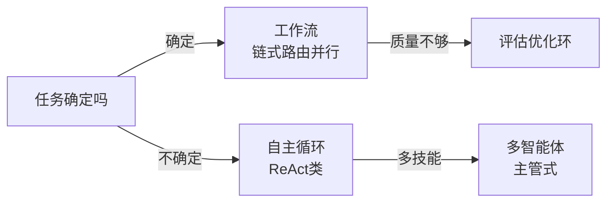

# Agent模式笔记

**摘要：** 组装 Agent 的可复用套路：任务确定用工作流，开放用自主循环，多技能用多智能体。与《Agent手册》分工：手册讲系统由什么组成，本篇讲怎么组装。资料源见文末（Anthropic 官方 + HF + 社区对照）。

**怎么读：** §1 先立选型观（简单优先）→ §2 五种工作流 → §3 单体推理 → §4 多智能体 → §5 记忆与工具 → §6 决策表。

## 1. 何谓模式与选型观

**一句话：模式是"给定任务形状的最简组装"——Anthropic 的核心忠告：能用确定性流程就别上自主循环，自主循环是最后手段。**

- **选型两轴：** 任务确定性（步骤是否可预枚举）× 步骤多少。确定且少 → 单次调用；确定且多 → 工作流；不确定 → 自主循环；多技能 → 多智能体。
- **复杂度税：** 每加一层循环/智能体，调试难度指数涨——先让最简方案跑通，再按失败归因加模式（思路见《RSI 笔记》§3.3）。

## 2. 五种工作流（Anthropic）

**一句话：五个可组合的积木——串行、分类、并行、分治、质检环，覆盖九成确定性任务。**

- **链式（chaining）：** 上一步输出即下一步输入；适合"步骤固定、每步可验"（如生成→校验→改写）。 gate：中间设校验门，失败即停。
- **路由（routing）：** 先分类再分发（客服意图/模型分级/语言）；分类器要准，错分代价高时加人工复核。
- **并行化（parallelization）：** 分片并跑再聚合（投票/多视角）；任务须独立，否则退化成串行等待。
- **编排-工人（orchestrator-workers）：** 主模型动态拆任务、子模型并行做、主模型汇总；适合"事先不知拆几块"（如深度 research）。
- **评估-优化（evaluator-optimizer）：** 生成→打分→再生成循环；评估器质量决定天花板（验证器瓶颈，见《RSI 笔记》§1）。
- **组合律：** 路由套链式、编排内嵌并行、全链尾挂评估环——按失败点加，不一次堆满。

## 3. 单体推理四模式

**一句话：ReAct 是基座（想一步动一步），其余三式分别补"复盘、规划、省 token"。**

| 模式 | 机制 | 适用 | 代价 |
| --- | --- | --- | --- |
| ReAct | 思考→行动→观察交错 | 开放任务、工具多 | 步数多、易漂移 |
| Reflexion | 失败后自然语言复盘入记忆 | 可试错、有明确判分 | 需好评估器 |
| Plan-and-Execute | 先出计划再逐步执行、偏差重规划 | 长任务、步骤可列 | 规划错全错 |
| ReWOO | 一次性全规划 + 工具变量替换 | 工具调用可预见 | 灵活性低 |

- **口诀：** 不可预测 → ReAct/Reflexion；可列计划 → Plan-and-Execute；调用固定 → ReWOO 省 token。

## 4. 多智能体协作

**一句话：主管制是默认答案（profile 隔离 + 任务分发），辩论与群集只用于"正确性压倒成本"的场景。**

- **主管-工人（supervisor）：** 主管拆任务、工人各精一技、主管汇总；LangGraph 子图即此。 profile 隔离防提示污染。
- **层级（hierarchical）：** 多层主管，用于超长链（组织架构映射）。
- **辩论（debate）：** 多智能体互驳 + 裁判，正确性最高、token 最贵（评测/安全场景）。
- **群集（swarm）：** 去中心交接，适合对等协作流程；难调试，要全链追踪。
- **成本警告：** 智能体数 × 步数 × 单步 token = 账单；先单体 + 工作流顶到头，再拆多智能体。

## 5. 记忆与工具模式

**一句话：记忆分三层（上下文/检索库/权重），工具走网关——两处都是《Agent手册》已有机制的"模式视角"重述。**

- **记忆三层：** 当轮上下文（快、贵）→ 检索库（经验/文档按需取，见 ReasoningBank）→ 权重（慢、稳）。热数据上浮、冷数据下沉。
- **Agentic RAG：** 检索本身进循环（改写查询 → 检索 → 自评 → 再检索），检索质量即答案质量。
- **工具网关：** 鉴权、限流、审计、幂等收一处；MCP 即标准化后的网关协议（见手册§4）。
- **评估即模式：** evaluator-optimizer 的评估器与记忆的验证器是同一个东西——验证器质量是所有循环的天花板。

## 6. 选型决策表

**一句话：按任务形状查表，默认从左往右试。**

| 任务形状 | 首选 | 不够再加 |
| --- | --- | --- |
| 固定多步 | 链式 | 中间加校验门 |
| 先分类后处理 | 路由 | 错分加人工复核 |
| 独立子任务多 | 并行化 | 投票聚合 |
| 拆法事先不知 | 编排-工人 | 尾挂评估环 |
| 开放探索 | ReAct | 失败加 Reflexion |
| 长计划任务 | Plan-and-Execute | 偏差重规划 |
| 多技能协作 | 主管-工人 | 正确性不够上辩论 |

## 参考资料

- Anthropic《Building Effective Agents》（工作流五式与"简单优先"）：https://www.anthropic.com/engineering/building-effective-agents
- HuggingFace《Design Patterns for Building Agentic Workflows》（六基座综述）：https://huggingface.co/blog/dcarpintero/design-patterns-for-building-agentic-workflows
- ReAct / Plan-and-Execute / ReWOO / Reflexion 四模式对照：https://theaiengineer.substack.com/p/the-4-single-agent-patterns
- Agentic Design Patterns 入门：https://aman.ai/primers/ai/agentic-design-patterns/
