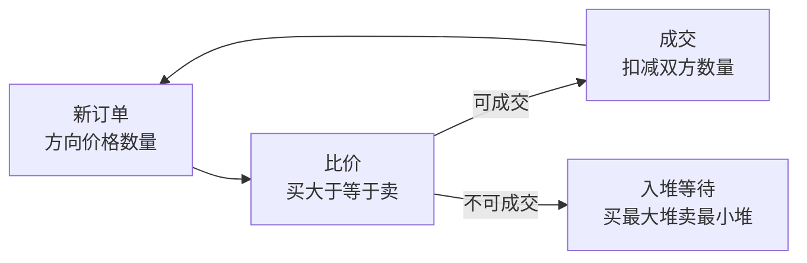

# 算法笔记

**摘要：** 数据结构手撕（LRU/日期/双端队列）+ 算法清单（字符串/数组/树/概率DP）+ 撮合引擎综合案例。与语言篇分工：语法细节回各语言篇，本篇只留"结构与思路"。

**怎么读：** §0 先立复杂度与选型直觉 → §1 手撕三题 → §2 清单按题型刷 → §3 撮合引擎走一遍堆与匹配。

## 0. 基础：复杂度与选型

**一句话：先报复杂度，再说结构——O(n log n) 是分水岭，O(1) 均摊要说清"均摊"二字。**

- **记号：** 时间/空间分开报；最好/平均/最坏分开说；递归复杂度用主定理（分治减子问题）或展开法。
- **选型表：** 数组（随机访问）/ 链表（头尾增删）/ 栈（括号/单调）/ 队列（BFS/滑窗）/ 堆（TopK/调度）/ 哈希（O(1) 查存在）/ 树（有序）/ 跳表（有序 + 并发友好）/ 并查集（连通）/ 字典树（前缀）。
- **评价算法四维：** 正确性（边界与反例）→ 复杂度（时间/空间/均摊）→ 稳定性（输入分布敏感度）→ 可实现性（可读可维护成本）。
- **刷题方法：** 按题型刷（同类三题即通），先暴力再优化，先讲思路再写码，写完自测边界（空/单元素/极大/重复）。

## 1. 数据结构手撕

**一句话：三题覆盖"哈希+有序""边界计算""组合结构"——手撕考的是不变量，不是背诵。**

### 1.1 LRU 缓存（常问）

- 不变量：HashMap（key→node）+ 双向链表（访问序）；Get/Put 都移到表头；满则删表尾。
- Python 3.7+ dict 自带顺序，可直接当有序字典用：

```python
class LRUCache:
    def __init__(self, capacity: int):
        self.capacity = capacity
        self.cache = {}

    def get(self, key: int) -> int:
        if key not in self.cache:
            return -1
        val = self.cache.pop(key)
        self.cache[key] = val
        return val

    def put(self, key: int, value: int) -> None:
        if key in self.cache:
            self.cache.pop(key)
        self.cache[key] = value
        if len(self.cache) > self.capacity:
            oldest_key = next(iter(self.cache))
            self.cache.pop(oldest_key)
```

- 进阶：线程安全版单锁最简单，高并发分段（见《系统设计笔记》§6.3）。

### 1.2 日期类相减

- 思路：都化成"距元年天数"再减；闰年规则（4 整除非 100 整除，或 400 整除）；月天数表 + 2 月特判。

```python
class Date:
    def __init__(self, y: int, m: int, d: int):
        self.y, self.m, self.d = y, m, d

    @staticmethod
    def is_leap(y: int) -> bool:
        return (y % 4 == 0 and y % 100 != 0) or (y % 400 == 0)

    @staticmethod
    def to_days(dt: 'Date') -> int:
        mdays = [31, 28, 31, 30, 31, 30, 31, 31, 30, 31, 30, 31]
        days = sum(366 if Date.is_leap(yy) else 365 for yy in range(1, dt.y))
        days += sum(Date.days_in_month(dt.y, mm) for mm in range(1, dt.m))
        return days + (dt.d - 1)

    @staticmethod
    def days_in_month(y: int, m: int) -> int:
        mdays = [31, 28, 31, 30, 31, 30, 31, 31, 30, 31, 30, 31]
        if m == 2:
            return mdays[1] + (1 if Date.is_leap(y) else 0)
        return mdays[m - 1]

    def __sub__(self, other: 'Date') -> int:
        return self.to_days(self) - self.to_days(other)
```

### 1.3 组合结构两题

- **双端队列全 O(1)：** 循环数组 + 头尾指针，随机 index 也是 O(1)；满时倍增搬迁（摊还 O(1)）。
- **集合插入 O(1) + 范围查：** 哈希（存在性）+ 有序结构（TreeSet/跳表，范围迭代），各取所长。

## 2. 算法清单

**一句话：按题型刷，括号栈、滑窗、前缀和、堆 TopK、树 DFS、DP 记状态——六个套路覆盖八成题。**

- **栈与字符串：** 括号匹配（栈）、最长不重复子串（滑窗）、全排列（回溯）、最长公共子序列/前缀（DP/字典树）。
- **数组：** 最大子数组和 Kadane（`curMax = max(nums[i], curMax + nums[i])`）、旋转数组查找（二分变体）、超 N/k 次（摩尔投票）、二维前缀和。
- **树：** 高度/对称/路径最大和（DFS 带回溯，路径要输出则记父指针）。
- **概率 DP：** 棋盘走 k 步仍在（LeetCode 688，DP 记分布）；最后一人坐对概率 1/2（对称性一句话）。
- **工程题：** 大文件找重复行（hash 分桶 + 外排序/位图）。
- **热身（括号/二维求和/装饰器参数校验）** 按§0 方法自测，不占正文。

## 3. 撮合引擎案例

**一句话：买单卖单各一个堆，按价格配对成交——堆 + 价格优先 + 数量扣减，三行即核心。**



```python
import heapq

class Order:
    def __init__(self, order_id, side, price, quantity):
        self.order_id, self.side, self.price, self.quantity = order_id, side, price, quantity

    def __lt__(self, other):
        # heapq 是最小堆：买单价格高优先（反向比），卖单价格低优先
        return self.price > other.price if self.side == 'buy' else self.price < other.price

class MatchingEngine:
    def __init__(self):
        self.bids, self.asks = [], []

    def place_order(self, order):
        book, counter = (self.asks, self.bids) if order.side == 'buy' else (self.bids, self.asks)
        while book and order.quantity > 0 and self._can_match(order, book[0]):
            top = book[0]
            qty = min(order.quantity, top.quantity)
            order.quantity -= qty
            top.quantity -= qty
            if top.quantity == 0:
                heapq.heappop(book)
        if order.quantity > 0:
            heapq.heappush(counter, order)

    @staticmethod
    def _can_match(order, top):
        return top.price <= order.price if order.side == 'buy' else top.price >= order.price
```

- **要点：** 买单最大堆、卖单最小堆（Python heapq 反向比较实现）；成交价取挂单方价格；余量入堆；生产级再加：价格时间优先、数量隐藏（冰山）、风控校验、自成交防范。

## 附：与他篇的边界

- 装饰器、单例、测试写法 → 《Java/Python笔记》§5–§6。
- LRU 并发版、线程池 → 《系统设计笔记》§6.3、《Java/Python笔记》§2。
- pandas 数据处理 → 数据向工具，不入本篇。
