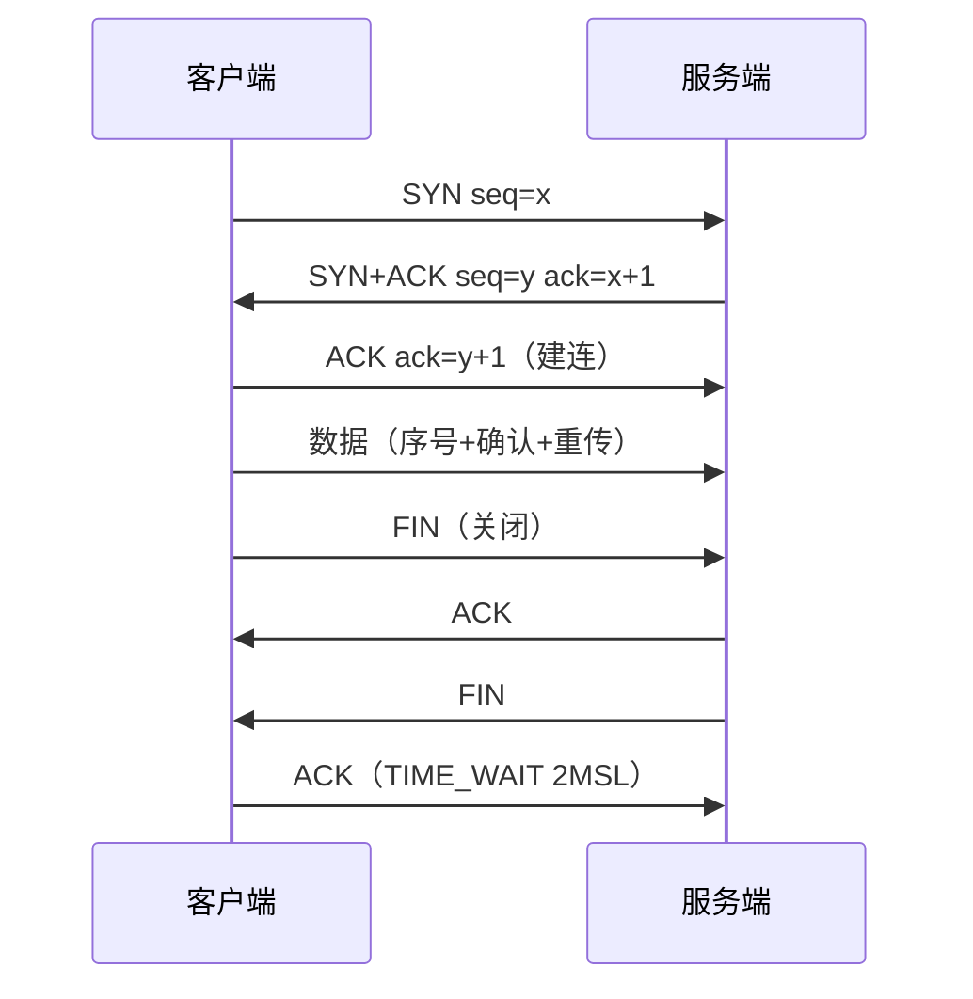

# 基础笔记

**摘要：** 一次请求之旅：浏览器发出 URL，DNS 指路，TCP/TLS 建连，网关转发，进程线程干活，虚拟内存供货——网络与操作系统在此相遇。与《Go笔记》（GMP/锁实现）、《存储笔记》（DB/缓存）分工：本篇讲 requests 之下的路和地基。

**怎么读：** §1–§2 跟请求走（DNS → TCP → HTTP），§3–§4 看地基（进程线程 → 内存），§5 看性能（缓存与延迟），§6 看安全。标"常问"的是高频口述点。

## 1. DNS 与建连

**一句话：DNS 把名字变地址（递归对用户、迭代对根），TCP 把地址变可靠连接（握手对序号、挥手保完整）。**

- **DNS：** 递归（解析器查出最终答案再返回）vs 迭代（每级给下一跳，查询方自己走）；通常 UDP/53，大报文/区传送/DoH 用 TCP；记录 A/AAAA/CNAME/MX/NS/TXT；缓存 + 负载均衡是常规操作。
- **三次握手/四次挥手：** 握手同步序列号建连；挥手保证数据完整关闭。滑动窗口做流量控制（ACK 推进），拥塞控制（慢启动/避免/快重传/快恢复）保吞吐。
- **TLS 握手：** ClientHello（版本/随机数/套件）→ ServerHello（证书/随机数）→ 协商会话密钥 → Finished 后对称加密通信。防劫持：证书链验到根 + 域名匹配 + HSTS。
- **HTTP 版本：** 1.1 持久连接 → 2 多路复用 + 头压缩 → 3 QUIC。状态码分段记（2xx/3xx/4xx/5xx）。

## 2. 传输细节

**一句话：TCP 为可靠付费（20 字节头 + 状态机），UDP 为轻量免单（8 字节头）——TIME_WAIT 和 MTU 是最常见的两个坑。**

- **TCP vs UDP（常问）：** TCP 面向连接、可靠有序字节流、拥塞控制、点对点；UDP 无连接尽力而为、报文、开销小、可一对多。
- **TIME_WAIT vs CLOSE_WAIT（常问）：** 前者主动关闭方等 2MSL（保 ACK 到达 + 旧报文消失，短连接多则多）；后者收到 FIN 但本端没 close（代码漏关连接）。
- **MTU：** 链路最大传输单元；超限分片（丢包放大 + 重组成本）或 PMTUD 探测。
- **socket 关闭读到什么：** 对端正常关读 EOF；异常断开可 `Connection reset`。本机 `127.0.0.1` 照样走协议栈（loopback 不开网卡）；UNIX 域 socket 不走 IP/TCP 更省。
- **SYN Flood：** 半连接耗 backlog；防：SYN cookie、调大队列、限流黑白名单、WAF/清洗、弹性扩容。

### TCP 建连时序与拥塞（常问）

- **拥塞控制四阶段：** 慢启动（指数涨）→ 拥塞避免（线性涨）→ 快重传（3 个重复 ACK 即重发）→ 快恢复（阈值减半续发）。
- **粘包/拆包：** TCP 是字节流无边界；解：定长包、分隔符、头体结构（先读定长头得长度再读体）。
- **UDP 适用：** DNS、QUIC（HTTP/3）、实时音视频（丢包可容忍、延迟敏感）、广播（DHCP）。

## 3. 进程、线程与同步

**一句话：进程是资源单位（隔离），线程是调度单位（共享）——切换成本差一个地址空间，通信方式差一套 IPC。**

- **区别（常问）：** 地址空间（进程隔离/线程共享）→ 切换成本（线程低，页表不用换）→ 通信（IPC vs 共享内存 + 同步）→ 选型（隔离稳定多进程，共享高并发多线程）。
- **PCB：** 寄存器上下文、页表/内存信息、打开文件、优先级——上下文切换保存恢复的就是它。触发：时间片、阻塞唤醒、中断/系统调用、优先级变化；贵在寄存器 + 地址空间/TLB 切换。
- **IPC：** 管道/命名管道、信号、消息队列、共享内存（配信号量，效率最高）、socket、文件锁。线程间：互斥/读写/自旋/条件变量/信号量/屏障/CAS。
- **死锁（常问）：** 互斥、占有等待、不可抢占、循环等待四条件全齐才死；解：统一加锁顺序、短持锁、超时、少嵌套；检测看资源分配图找环。
- **池化：** 复用昂贵资源（连接/对象/线程），减创建销毁与系统调用，平滑突发、有界限并发。

### 进程通信对照（常问）

| 方式 | 亲缘要求 | 方向 | 要点 |
| --- | --- | --- | --- |
| 匿名管道 | 父子 | 单向 | 简单，容量小（常 64KB） |
| 命名管道 | 无 | 单向 | 文件路径 rendezvous |
| 信号 | 无 | 单向通知 | 只传事件不传数据（INT/TERM/KILL/HUP） |
| 消息队列 | 无 | 双向 | 内核持久，按类型取 |
| 共享内存 | 无 | 双向 | 最快（零拷贝），同步自理 |
| socket | 无 | 双向 | 本机/跨机统一，UDS 更省 |
| 文件锁 | 无 | 互斥 | 跨进程互斥与 rendezvous |

- **常用信号：** INT（Ctrl+C，可捕）/ TERM（优雅退出，默认）/ KILL（强制，不可捕）/ HUP（断开，常作重载配置）。
- **共享内存难点：** 进程间同步（共享互斥量/futex/无锁队列）、崩溃恢复（谁清理）、对齐与版本兼容。
- **线程同步方式：** 互斥量（mutex）、自旋锁（短临界）、读写锁（读多）、条件变量（等待+唤醒）、信号量（计数限流）、屏障（barrier 会合）、原子操作（CAS）。

## 4. 虚拟内存

**一句话：进程活在虚拟地址里，MMU + 页表 + TLB 负责翻译，缺页异常负责按需进货。**

- **机制：** demand paging（缺页进货）、COW（写时复制）、权限位（R/W/X）、mmap、swap。价值：隔离安全、按需加载、共享只读页。
- **页 vs 段（常问）：** 页固定大小、用户不可见、无外部碎片（有内部）；段按逻辑模块可变长、用户可见、有外部碎片；段页式兼得。
- **缺页过程：** 访问不在内存 → 异常 → 查权限 → 磁盘/交换区调页 → 更新页表 TLB → 重执行指令。
- **置换算法：** LRU/LFU（留近期高频，工程常用近似）、FIFO（有 Belady 异常）、Clock（访问位近似 LRU）。
- **分配器：** 伙伴系统 + slab；优化看工作集（热点常驻、预读）与取舍（内存换 swap、吞吐换延迟）。
- **容器 vs 虚拟机：** 容器共享宿主内核（轻），虚拟机虚拟硬件 + 完整 OS（隔离强）。用户态/内核态以系统调用（trap）为界。

### 文件系统、调度与 IO 模型

- **文件系统：** inode 存元数据（目录是"名→inode"映射）；硬链接同 inode（删原文不影响），软链接是路径（断链即坏）；IO 模型：阻塞/非阻塞、同步/异步、多路复用。
- **Linux 调度与中断：** CFS 完全公平调度（vruntime 小的先跑）；中断分顶半部（硬中断速记）+ 底半部（软中断/tasklet/工作队列慢慢做）。
- **epoll LT vs ET：** LT 有数据就持续通知（好写）；ET 状态变化才通知（高吞吐，须循环读写到 `EAGAIN`）。Java NIO 的 Selector 即 Reactor 封装，见《Java/Python笔记》§3。

## 5. 性能：缓存、局部性与延迟

**一句话：性能优化就是减少"慢层"访问——局部性保命中、对齐保 MESI、延迟表定量级。**

- **局部性：** 时间（刚用过还会用）+ 空间（相邻会一起用）；优化：连续内存、按行访问、分块、减分支、减指针追逐。
- **MESI 与伪共享（常问）：** 多核靠缓存一致性协议保可见；不同变量落同 cache line 被多核写 → 反复失效（伪共享）。解：64B 对齐填充、按线程分片、消灭共享写热点。Go 端见《Go笔记》§2。
- **AoS vs SoA：** 对象数组易写，字段数组易批量（SIMD/缓存友好），看访问模式选。
- **延迟量级（常问，数量级即可）：** L1 ~0.5ns → 互斥锁 ~25ns → 内存顺序读 ~100ns → SSD 随机读 ~150us → 同机房 RTT ~0.5ms → 磁盘寻道 ~10ms → 跨国 ~150ms+。估算瓶颈先查表：差三个量级就不用压测了。
- **零拷贝：** sendfile/mmap 减用户态内核态往返（Go `io.Copy` 自动用，见《Go笔记》§6）。
- **CPU 飙升排查：** 先分用户态/系统态（top 按线程拆）→ jstack/火焰图定位 → 死循环/GC/自旋/日志刷屏/重试风暴逐一对。

## 6. 安全与会话

**一句话：Cookie 存客户端必须签名，会话放服务端必须旋转，跨域与注入按清单防。**

- **Cookie vs Session（常问）：** Cookie 存客户端，Session 是服务端状态；防伪：内容签名/加密、SessionID 纯随机、HttpOnly/Secure/SameSite、登录后旋转、防 CSRF token。
- **JWT 本质：** 声明 + 签名，验签后信任（私钥签名、公钥验签，防篡改）。
- **清单：** XSS/CSRF/SQL 注入输入校验；CORS 跨域；CDN/WAF/DDoS 防护分层。

## 附：与他篇的边界

- GMP 调度、锁的语言实现 → 《Go笔记》§2、《Java/Python笔记》§2。
- Reactor/epoll 的框架用法（Nginx/Gin/Netty）→ 《系统设计笔记》§1、《Go笔记》§4。
- 延迟表是估算工具，压测与容量规划 → 《系统设计笔记》§5。
