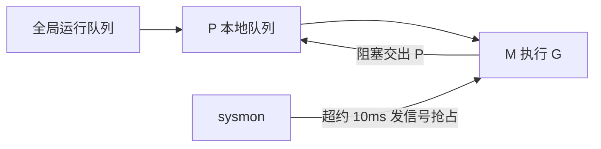
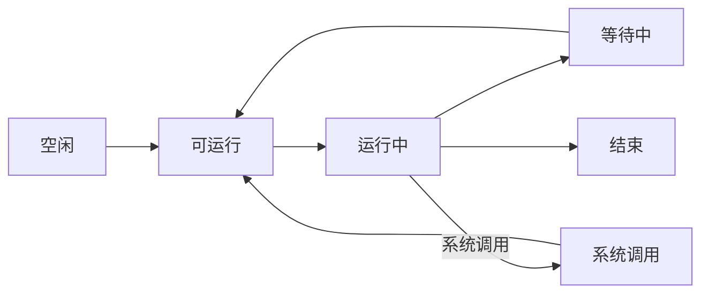
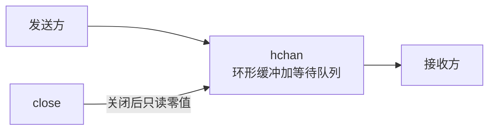
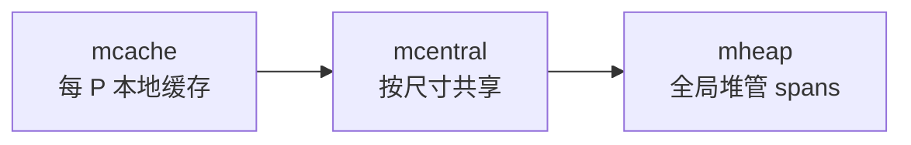

# Go笔记

**摘要：** Go 语言底层复习：先过类型与错误（怎么写对），再看并发（怎么调度与同步），最后看内存（谁分配谁回收）与工程。与《Agent手册》的分工：手册讲 Agent 系统，本篇讲语言底座；缓存一致性等偏硬件内容见《基础笔记》，MySQL/Redis 串场见《存储笔记》。

**怎么读：** §1 语言基础（类型 + 错误，写对代码）→ §2 并发（GMP + channel + 锁，怎么调度与同步）→ §3 内存（分配器 + GC + 逃逸）→ §4–§5 工程与性能。每节先给结论，再给机制，标"常问"的是高频口述点。

## 1. 语言基础：类型与错误

**一句话：Go 的坑集中在"引用语义"和"nil 语义"——slice 会分家、map 并发 panic、接口 nil 不是 nil；错误显式处理，panic 只管当前 G。**

### 1.1 slice、map 与接口（常问）

- **slice：** 指针 + len + cap 描述符，指向底层数组；append 可扩容"分家"；子切片拽着大数组会导致内存泄漏，断开用 copy。深拷贝用内建 `copy`，赋值只拷指针。
- **map：** 哈希桶 + 溢出桶，负载因子触发渐进扩容；**并发读写 panic**。方案：外部加锁、分片 map、`sync.Map`（读多写少、键稳定场景）。
- **interface nil（常问）：** 接口值 = 动态类型 + 动态值；`var e error = (*MyErr)(nil)` 动态类型非空，所以 `e != nil`。返回前给真正的 nil。
- **make vs new：** `new(T)` 返回清零指针；`make` 只用于 slice/map/channel，返回引用本身并初始化内部结构。
- **传值还是传指针：** 大结构体传指针（省拷贝、可修改）；小结构体可传值（防逃逸到堆、不可变）。
- **rune 与 uint：** `rune` 是 `int32` 别名（Unicode 码点），`for range` 字符串得到的是 rune；无符号整数溢出按模回绕不抛异常，可疑处用 `math/bits` 或前置范围检查。

### 1.2 defer、panic 与错误处理（常问）

- **defer：** 后进先出，常用于释放资源与统一收尾。
- **panic：** 沿当前栈展开并执行 defer；未捕获的 panic 会崩掉整个进程（`runtime.crash`，其他 G 感知不到）。
- **recover：** 只能在 defer 里生效，**只管当前 G**——子 goroutine 必须自己 defer + recover。一个 G 的 panic 会连累整进程，这是"每个 G 必须有退出与兜底"的原因（呼应§2.3）。
- **错误处理：** `%w` 包裹保留根因，顶层（如 Gin 中间件）统一收口记日志；业务错误给自定义码，系统错误走 500。

## 2. 并发：GMP 调度与同步

**一句话：GMP 管"谁在哪个核上跑"，channel 管"goroutine 之间怎么交接"，锁管"共享内存谁进临界区"——三者分工不同，混用是泄漏与死锁之源。**

### 2.1 GMP 调度模型（常问）



- 线程模型：1:1（内核级）、N:1（用户级）、M:N（两级）。Goroutine 基于 M:N，由 runtime 调度。
- G：轻量任务，初始栈 2KB（OS 线程 2–8MB），可扩到 1GB（64 位）；M：OS 线程，真正执行；P：逻辑处理器，持本地队列 + work-stealing。
- G 的状态：空闲 → 可运行 → 运行中 → 等待/系统调用 → 回可运行 → 结束。



- **常问：G 什么时候阻塞？** channel 读写（读空、写满）、网络 I/O（netpoller 接管，不占 M）、锁竞争、系统调用（M 可被剥夺 P）、`time.Sleep` / `runtime.Gosched()`。
- **抢占：** Go 1.14+ 异步抢占，sysmon 发现长运行 G 发 SIGURG 强制让出；GC 栈扫描也靠 safepoint 让 G 尽快可扫描。

### 2.2 channel：交接的语义（常问）



- 无缓冲：发送与接收必须同时发生，是同步点（handoff），用于严格顺序；有缓冲：容量内不阻塞，用于削峰解耦。
- `close` 表示"不会再发送"，接收用 `v, ok := <-ch` 判断关闭且耗尽。
- **关闭三原则：** 只由发送方关闭；不对已关闭 channel 发送（panic）；不重复关闭（panic）。所有权设计时定死。
- **底层 `hchan`：** 环形缓冲指针、元素大小、容量、读写索引、关闭标志、互斥锁、收发等待队列（`waitq`，节点 `sudog`）。无缓冲走等待队列直接交接，有缓冲走环形数组；并发 send/recv 安全。
- `make(chan T, n)` 返回引用，底层 `hchan` 通常在堆上。
- **select：** 多路操作，就绪多分支伪随机选防饥饿；`default` 易致 busy loop，配 sleep/阻塞或退避。

顺序打印（cat/dog/fish 交替 100 次，channel 接力即答案）：

```go
cat := make(chan struct{})
dog := make(chan struct{})
fish := make(chan struct{})
go func() {
    for i := 0; i < 100; i++ {
        <-cat
        fmt.Println("cat")
        dog <- struct{}{}
    }
}()
go func() {
    for i := 0; i < 100; i++ {
        <-dog
        fmt.Println("dog")
        fish <- struct{}{}
    }
}()
done := make(chan struct{})
go func() {
    for i := 0; i < 100; i++ {
        <-fish
        fmt.Println("fish")
        if i == 99 {
            close(done)
            return
        }
        cat <- struct{}{}
    }
}()
cat <- struct{}{}
<-done
```

### 2.3 锁、原子操作与泄漏

- **Mutex 是悲观锁（常问）：** 先互斥再进临界区；乐观锁反之（先改，CAS/版本号验冲突、失败重试）。
- **两种模式（常问）：** normal 偏吞吐（新来 G 与被唤醒 G 竞争）；starvation 偏公平（久等者优先，防尾延迟拉爆）。
- **底层：** `int32 state`（锁定/唤醒/饥饿/等待数）+ CAS + 信号量；竞争时有限自旋，超阈值 park 让出 P。
- **RWMutex：** 多读并发、写独占，读多写少；写会挡后续读（防写饥饿）。
- **常问：项目里用过哪些锁？** `Mutex` / `RWMutex` / `Once` / `Cond` / `atomic`（计数器、状态机）/ channel 替共享。经验：锁粒度小、热点分片、锁顺序一致、临界区内不做 IO。
- **三种线程安全写法：** 共享内存+同步、消息传递（状态收进单 goroutine 用 channel 序列化）、分片隔离（按 key 拆 shard）。
- **Once/Cond/Pool：** Once 保初始化一次；Cond 等待/唤醒；Pool 复用临时对象降 GC（不保证命中）。
- **atomic 注意：** 只保单变量，复合不变量仍要锁。
- **goroutine 泄漏（常问）：** 收发永远等不到、未关闭 channel、未取消 context、timer 泄漏、`WaitGroup` 失配、无退出条件的死循环。排查：pprof goroutine 看阻塞点，每个 G 配退出条件与超时。
- **自旋占 CPU：** 先定位（忙轮询、锁自旋、`select default` 热循环），再改阻塞等待、加退避与 `Sleep`、拆锁、调 `GOMAXPROCS`。
- **context 取消传播：** `WithCancel/Timeout/Deadline` 跨 G 传取消与 deadline，用完调 cancel；ctx 放第一个参数，不塞结构体长期持有。

### 2.4 Go 内存模型：并发语义（常问）

**一句话：内存模型不管内存放哪（那是§3.1 分配器的事），只管"一个 G 的写，另一个 G 什么时候看得见"——答案：只靠同步原语建立 happens-before，不靠 sleep 和直觉。**

- **程序内顺序：** 单 G 内按代码顺序可见（编译器/CPU 重排对外不可见）。
- **创建与结束：** `go` 语句之前的操作 → 新 G 可见；G 内全部操作 → 检测到它结束（Done/Wait/Join）后可见。
- **Channel：** 第 n 个发送 → 第 n 个接收完成可见；`close` → 收到零值（`ok=false`）处可见；有缓冲容量 C 时，第 k 个接收 → 第 k+C 个发送完成可见（这就是"缓冲 C 个" 的语义来源）。
- **锁：** 第 n 次 `Unlock` → 第 n+1 次 `Lock` 可见；`Once.Do(f)` 中 f 的执行 → 每次返回后可见。
- **错误示范（常问）：** 轮询标志位不同步，读到什么都不保证——

```go
var a string
var done bool
func setup() { a = "hello, world"; done = true }
func main() {
    go setup()
    for !done { // 错误：无同步！
    }
    print(a) // 可能打印空串
}
```

- **修法：** done 换 channel 关闭/ mutex/ atomic/ WaitGroup 任一，happens-before 即成立。
- **与§3.1 的分工：** 本节管"可见性语义"，§3.1 管"变量住栈还是住堆"——一个管对错，一个管快慢。

## 3. 内存、GC 与逃逸

**一句话：小对象走本地缓存，大对象走全局堆；GC 按"上次存活堆 × (1+GOGC)"触发三色标记；逃逸分析决定变量住栈还是住堆——压住逃逸就是压住 GC。**

### 3.1 分配器与 GC（常问）



- **分层（TCMalloc 思想）：** mcache → mcentral → mheap。小对象按 size class 从 span 切（微小 <16B、小 16B–32KB、大 >32KB 单独大 span）。
- **触发：** 堆分配达上次存活堆 × (1 + GOGC/100)；也可定时或 `runtime.GC()`；`debug.SetGCPercent` 调阈值。
- **三色标记：** 白（未访问）→ 灰（已访问、引用未处理）→ 黑（处理完）；并发标记 + 混合写屏障；调参看 GOGC、GOMEMLIMIT。


- **其他 GC 制式（对照用）：** 引用计数（怕环）、分代（朝生夕死）、复制/标记-清扫/标记-整理。

### 3.2 逃逸分析（常问）

- 编译器决定变量住栈（快，自动释放）还是住堆（慢，GC 管）。
- **五类必逃逸：** 返回局部指针；装进 `interface{}`（如 `fmt.Println(a)`）；变量过大超栈；被闭包长期引用；slice/map/channel 里存指针。
- 排查：`go build -gcflags="-m"` 看逃逸日志。
- **小对象多为什么 GC 压力大：** 分配频繁、标记对象多、指针追踪与写屏障开销大。看的是"存活对象数 × 指针图复杂度"，不是字节数。

### 3.3 OOM 与泄漏排查

- **常问：线程 OOM vs goroutine OOM？** 前者整进程被 OOM Killer SIGKILL；后者同样整进程 crash（`out of memory` 不可 recover）。
- **常见病因：** map 无界增长、slice 拽大底层数组、缓存无淘汰、goroutine 泄漏、日志/队列堆积。
- **排查链：** pprof（heap/goroutine）→ 指标（RSS、heap inuse）→ 压测复现 → 加上界与淘汰 → 限流分页。

## 4. 工程：框架、可观测与标准库

**一句话：Web 层 Gin/net/http 起手，RPC 用 gRPC，DB 用 gorm；可观测 pprof + 日志先行；反射和 tag 是框架的筋。**

- **Gin（常问）：** `ShouldBindJSON` 绑参，底层 `go-playground/validator`（tag 如 `binding:"required,min=1,max=10"`）；中间件 `router.Use` + `c.Next()` 做 Auth/日志/限流；错误用 `c.Error` 收集、中间件 `c.Errors.Last()` 统一处理；自定义校验 `validator.Engine().RegisterValidation`，返回 bool。
- **net/http 高频：** 读/写/空闲超时必配；按接口限流、goroutine 与下游连接池隔离；`http.Server.Shutdown(ctx)` + 信号（`os/signal.Notify` 收 SIGTERM）优雅停，等 in-flight 做完。
- **testing/benchmark：** 表驱动、边界覆盖、不依赖外部环境；`b.ResetTimer()` 剔初始化，看 allocs/op。
- **pprof 三板斧：** CPU 看热点/锁竞争/自旋；heap 看 inuse/alloc 找大对象与泄漏；goroutine 看阻塞点。
- **反射与 tag：** `reflect.TypeOf(obj).Field(i).Tag.Get("json")` 取 tag；原理是拆 `eface` 的 `_type` + `data`；调函数 `reflect.ValueOf(fn).Call(...)`。开销大，只用框架层。
- **标准库速记：** `net/http`（HandleFunc + 中间件）、`database/sql`（连接池 + 预处理）、`context`（取消超时）、`encoding/json`（tag 控字段，极热路径换 sonic）。

## 5. 性能优化八式

**一句话：少分配、少拷贝、少反射——八式全是这三件事的实例。**

1. **字符串拼接：** `+` 产中间对象，用 `strings.Builder`（先 `Grow` 预分配）。
2. **切片深拷贝：** 赋值只拷指针，用内建 `copy`。
3. **大文件拷贝：** `io.Copy` 在 Linux 自动走 `sendfile` 零拷贝；或 `mmap` 映射。
4. **临时大对象：** `sync.Pool` 复用（如 1KB buffer），`Get` 配 `defer Put`。
5. **周期任务：** `time.Ticker` + `defer Stop()`，防 `time.After` 循环堆积。
6. **JSON：** 极热路径 `encoding/json` 换 sonic（JIT）。
7. **日志：** `slog` 起手（1.21 官方结构化），极致性能换 zap。
8. **高并发读写 map：** 分段锁（32 shard 各配 RWMutex），命中读多写少才用 `sync.Map`。

```go
var bufPool = sync.Pool{New: func() interface{} { return make([]byte, 1024) }}
func process() {
    buf := bufPool.Get().([]byte)
    defer bufPool.Put(buf)
}
```

## 附：与他篇的边界

- 缓存一致性（MESI/伪共享/内存对齐）、Linux 信号语义 → 《基础笔记》。
- MySQL 锁与分库分表、Redis 分布式锁/主从集群/持久化 → 《存储笔记》。
- 负载均衡算法（轮询/一致性哈希/最少连接）→ 《系统设计笔记》。
