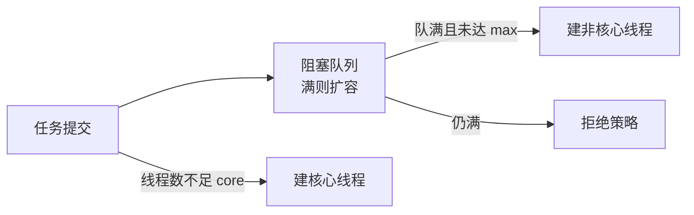
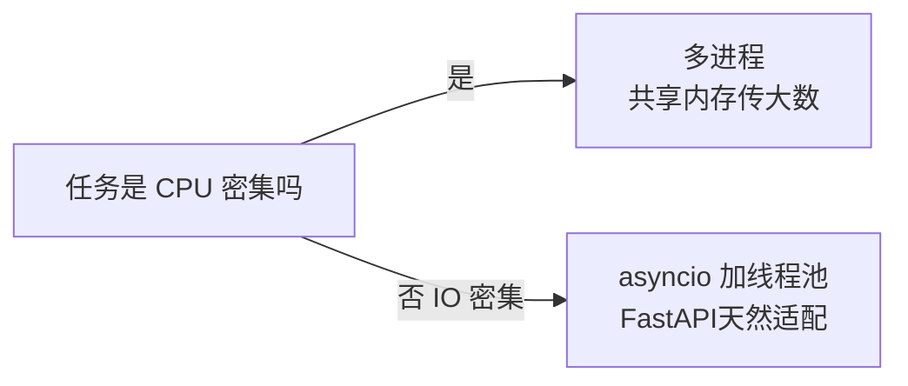

# Java/Python笔记

**摘要：** 双栈对照复习：Java 生态（JVM/GC/JUC/Spring，重型企业级）与 Python 生态（GIL/并发模型/FastAPI，胶水与数据）。与《Go笔记》分工：并发思想相通，语言机制各表一边；对照表收在§7。

**怎么读：** §1–§4 Java（JVM → 并发 → 集合IO → Spring），§5–§6 Python（基础 → 并发与 Web），§7 对照。标"常问"的是高频口述点。

## 1. JVM：内存、类加载与 GC

**一句话：线程共享区（堆/元空间）归 GC 管，线程私有区（栈/PC）随线程生死；调优就是调堆大小和收集器。**

| 区域 | 存什么 | 异常典型 |
| --- | --- | --- |
| 堆 | 对象实例、数组 | `Java heap space`、`GC overhead limit exceeded` |
| 元空间 | 类元数据、常量池（JDK8+ 在本地内存） | `Metaspace` |
| 虚拟机栈 | 栈帧（局部变量表/操作数栈/动态链接/返回地址） | 过深 `StackOverflowError` |
| 本地方法栈 | JNI 本地方法 | 同上 |
| 程序计数器 | 字节码行号 | 几乎不 OOM |

- **类加载：** 加载 → 连接（验证/准备/解析）→ 初始化；双亲委派防核心类篡改；触发：`new`、静态访问、反射、子类初始化带父类。
- **GC 五维（常问）：** 分代（Eden+S0/S1 → 老年代，朝生夕死）→ 可达性分析 → 收集器（CMS 退场、G1 默认、ZGC/Shenandoah 低停顿）→ 参数（`-Xms/-Xmx/-Xss/-XX:MaxMetaspaceSize`）→ Full GC 排查（看 GC 日志触发原因 + 堆转储找大对象，修泄漏/加大堆/调 G1）。
- **OOM 排查链：** 定位变化面（发布/流量/数据）→ 取证（heap dump、GC 日志、jstack）→ MAT/VisualVM 找大对象引用链（静态集合、缓存无上限、ThreadLocal 未清理）→ 修 + 压测验证。
- **字节码与指令：** 常量入栈/加载存储/栈操作/算术比较/跳转/调用返回，栈机模型；RTTI（`instanceof`、Class 查询）；反射走元数据（慢，缓存/MethodHandle 改善）；clone 默认浅拷贝。
- **接口默认方法：** Java 8 `default` 兼顾兼容与覆盖；多接口同名必须显式覆盖。异常体系：Checked 强制处理，Unchecked（`RuntimeException`）可传播。

## 2. Java 并发：JUC 全家桶

**一句话：线程池管任务，volatile 管可见，AQS 管排队，CHM 管并发容器——口述按"四种线程安全思路"收口。**

- **线程池七参（常问）：** core/max/keepAlive/队列/工厂/拒绝策略。流程：不足 core 建线程 → 入队 → 队满且未达 max 建线程 → 拒绝（Abort/CallerRuns/Discard/DiscardOldest）。协作式停止（`interrupt`/标志位），不用废弃 `suspend`。
- **CompletableFuture：** `supplyAsync/runAsync`（配自定义池）→ `thenApply/thenCompose/thenCombine/allOf/anyOf` → `exceptionally/handle/whenComplete` 兜底。
- **volatile 三件事（常问）：** 可见性（刷新主存）+ 有序性（内存屏障）− 原子性（`count++` 仍不行）。场景：状态开关、DCL 单例。
- **happens-before 八条：** 程序次序、锁解锁、volatile 写读、`start`、终止 `join`、中断、构造完成、传递性。
- **synchronized vs ReentrantLock（常问）：** 都可重入；后者多出可中断、可超时 `tryLock`、公平选项、多 Condition；底层前者 Monitor + 锁优化（偏向/轻量/重量），后者 AQS + CAS。
- **AQS：** `state` + CAS + FIFO 等待队列 + Condition 双队列；`acquire/release` 独占，共享给读锁。
- **CHM（常问）：** JDK8 put：spread 定 bin → 空 CAS 放 → MOVED 帮扩容 → 锁头插链/树；get 无锁读。size 用 `baseCount + CounterCell` 分段。
- **线程安全四思路：** 不共享（封闭）、不可变（final）、只读（初始化期写完）、同步（锁/原子/并发容器）。CAS 本质 `cmpxchg` + 重试，ABA 加版本号。
- **sleep vs wait：** 前者 Thread 静态、不放锁、超时醒；后者 Object 方法、放锁、需 notify。

## 3. Java 集合、IO 与网络编程

**一句话：集合按"有序否/并发否"选型，IO 按"BIO 一连接一线程还是 NIO Reactor"选型。**

- **选型表：** List 有序可重复（ArrayList 读多/LinkedList 头尾）；Set 去重（HashSet/TreeSet）；Map 按场景（HashMap 通用、LinkedHashMap 保序、TreeMap 红黑树排序、ConcurrentHashMap 并发、WeakHashMap 缓存）。
- **红黑树：** 自平衡，O(log n)；链表二分到不了 O(log n)（无随机访问），替代是跳表（Redis zset 即此）。
- **BIO/NIO：** BIO 一连接一线程；NIO 非阻塞 + Selector（Reactor），少量线程扛大量连接；epoll LT 持续通知、ET 边沿通知（读到 `EAGAIN`）。
- **socket 关闭：** 对端正常关读到 EOF；异常断开可 `Connection reset`。

## 4. Spring：容器、AOP 与事务

**一句话：IoC 管对象生死，AOP 管横切逻辑，事务是 AOP 最经典的横切——自调用绕过代理是第一失效源。**

- **IoC：** Resource 定位 → BeanDefinition 载入 → 注册容器；单例/原型/request-session 作用域；单例依赖多例用 Provider/方法注入。
- **循环依赖三级缓存（常问）：** singletonObjects（成品）→ earlySingletonObjects（半成品）→ singletonFactories（代理工厂）。解 setter 循环，不解构造器循环。
- **AOP：** JDK 动态代理（接口）或 CGLIB（子类）；拦截器链织入 before/after/around。
- **事务失效（常问）：** 同类自调用（绕代理）、方法非 public/final、异常被吞或类型不匹配回滚规则（默认 RuntimeException）。检异常回滚：`rollbackFor = Exception.class`。传播 REQUIRED/REQUIRES_NEW/NESTED 常用三档；隔离级别一般跟库默认。
- **SPI：** Java `ServiceLoader`（`META-INF/services`）；Spring 老 `spring.factories`、新自动装配 imports。
- **MVC 流程：** DispatcherServlet → HandlerMapping → HandlerAdapter → Controller → ViewResolver 渲染。异常 `@ControllerAdvice` 统一收口；多实现注入用 `@Qualifier/@Primary` 或 List 注入自选。

## 5. Python 基础：语法、内存与习惯

**一句话：动态类型的代价是运行时语义——可变性、引用传递、GIL 三件事决定代码怎么写。**

- **可变 vs 不可变：** list/dict/set/bytearray 可变；int/str/tuple/frozenset 不可变。浅拷贝只拷外层，深拷贝 `deepcopy` 全独立。
- **传参：** 传对象引用——可变对象就地改影响外部，重绑形参不影响。`is` 比身份，`==` 比值。
- **方法三件：** 实例方法（self）、类方法（cls，工厂）、静态方法（组织代码）；`@property` 转属性；`functools.wraps` 保元信息。
- **生成器与闭包：** `yield` 暂停保状态（大文件/管道/分页）；闭包捕获自由变量；`with` 管资源（`__enter__/__exit__`）。
- **内存管理（常问）：** 引用计数为主（零即回收，怕环）+ gc 分代收环 + pymalloc 小对象池。泄漏排查：`with/close` 管资源、缓存加 LRU/TTL 上限、环上不用 `__del__`（或 weakref）、`tracemalloc` + `gc` 定位、区分 Python 堆与 native 内存。
- **GIL（常问）：** 同一时刻一线程跑字节码；CPU 密集多线程不并行，IO 密集可提吞吐。解法：多进程、释 GIL 的 C 扩展/NumPy；3.13 无 GIL 构建在路上。
- **测试与性能：** `unittest.mock.patch` 打桩；cProfile/line_profiler/memory_profiler 三件；列表推导、生成器、局部变量是常规优化。

## 6. Python 并发与 Web

**一句话：CPU 用多进程、IO 用 asyncio/线程、Web 用 FastAPI——选型先于优化。**

- **进程/线程/协程：** 进程隔离强、绕 GIL 并行；线程共享内存、CPU 受 GIL 限；协程（asyncio）用户态调度、扛海量 IO。IPC：Pipe/Queue、shared_memory、Manager，跨机用 Redis/MQ/RPC。
- **多进程求和模式：** 共享内存放 numpy 数组 → 按核分片起进程 → join 汇总。`if __name__ == "__main__"` 守卫，大数用 `shared_memory` 避拷贝。
- **竞争与死锁：** 共享可变是根因；锁/队列/少共享/幂等；统一加锁顺序、短持锁、超时、防嵌套。
- **FastAPI 链路（常问）：** Uvicorn（ASGI）→ 路由 → Depends 注入（鉴权/DB session/分页限流）→ Pydantic 校验 → endpoint → 序列化。ASGI 原生 async + WebSocket，区别于 WSGI 同步模型。
- **鉴权与中间件：** JWT（过期 + 签名，`Authorization: Bearer`，依赖里验签）+ 中间件（跨域/日志/trace/异常兜底，忌阻塞调用）。后台任务轻量 `BackgroundTasks`，重活走 Celery/RQ/APScheduler。
- **框架地图：** FastAPI（Starlette + Pydantic，异步 API）、Django（全功能 MTV）、Flask（轻量）；NumPy/Pandas/Sklearn 管数据科学。

## 7. 双栈对照表

**一句话：并发看 GMP vs GIL+多进程，内存看三色 vs 引用计数+分代，Web 看 Gin vs FastAPI——同题两边各答一遍，复习效率翻倍。**

| 维度 | Go（见《Go笔记》） | Java / Python（本篇） |
| --- | --- | --- |
| 并发模型 | GMP 用户态调度，无 GIL | Java 线程 + 池；Python GIL，多进程/asyncio 绕行 |
| GC | 三色标记 + 写屏障，GOGC 调 | Java 分代/G1/ZGC；Python 引用计数 + 分代收环 |
| 内存坑 | 逃逸、slice 分家 | Java OOM 四型排查；Python 环引用 + native 泄漏 |
| 锁 | Mutex/channel 为主 | Java AQS 全家桶；Python 锁 + 队列 + 少共享 |
| Web | Gin/net-http/gRPC | Spring MVC/Boot；FastAPI（ASGI） |
| 适用 | 高并发 infra、云原生 | Java 企业级；Python 胶水/数据/AI |

## 附：与他篇的边界

- 数据库三件（varchar/index）已并入《存储笔记》；Spark/Dask、量化金融名词本次不入篇。
- 并发思想（happens-before、幂等、池化）三篇通用，细则各归其篇。
