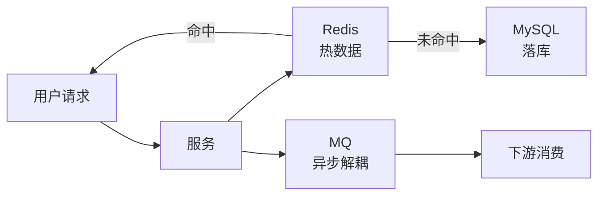

# 存储笔记

**摘要：** 落库 MySQL 管可靠、热数据 Redis 管快、MQ 管异步解耦——三者在请求链路中分工不同。本篇按"链路位置 → 单件原理 → 可靠性三问 → 三件套对照"组织，缓存双写与事务消息等联动点收在§4。

**怎么读：** §1 MySQL（索引与事务）→ §2 Redis（缓存与分布式能力，含一致性深水区§2.4）→ §3 MQ（异步与可靠性）→ §4 联动（双写一致性 + 可靠投递）→ §5 三件套事务一致性对照。标"常问"的是高频口述点。

## 1. MySQL：索引与事务

**一句话：读靠 B+ 树索引（防回表），写靠 redo/undo + 锁（保事务），量大靠分片（读写分离、分库分表）。**

### 1.1 B+ 树与索引（常问）

- **结构：** 非叶子只存 key + 指针，扇出大、树矮、磁盘 IO 少；叶子有序链表，范围查询与排序友好。对比：B 树每层都存数据，扇出小树更高；Hash 索引只擅点查；LSM（SSTable）写友好读放大；倒排索引管全文检索；R-tree 管空间索引。
- **聚簇 vs 辅助：** 聚簇索引叶子存整行（一般主键组织表）；辅助索引叶子存主键值，查整行要**回表**。`select` 字段全在二级索引里即**覆盖索引**，免回表。
- **常问：怎么避免回表？** 建覆盖索引（含联合索引）、只取必要字段、联合索引注意列顺序、索引下推缩扫描。
- **常问：Join 能否用索引？** 能。Index Nested-Loop Join（小表驱动大表），被驱动表 join key 有索引才快；无索引则退化为大量回表/全表扫描。
- **哪些列建索引：** `where/join/order by/group by` 的高选择性字段；忌：频繁更新且选择性差的列、对列做函数/隐式转换（索引失效）、`LIKE '%xxx'`、OR 散射。`varchar` 波动大用变长，`char` 适合短定长。
- **NULL 与空串：** NULL 是未知，比较用 `IS NULL`；`count(col)` 不统计 NULL；`''` 是值。必要字段尽量 `NOT NULL`。

### 1.2 事务、锁与复制

- **ACID 落点：** 原子性靠 undo，持久性靠 redo，隔离性靠锁 + MVCC，一致性靠约束与应用逻辑。
- **隔离级别：** READ UNCOMMITTED（脏读）→ READ COMMITTED（防脏读）→ REPEATABLE READ（MySQL 默认，防不可重复读）→ SERIALIZABLE（全串行）。
- **InnoDB 锁：** 行锁（Record/Gap/Next-Key，Next-Key 防幻读）、表锁（意向锁）、`SELECT ... FOR UPDATE` 配事务；锁与事务边界一致，忌长事务。
- **主从复制：** 全量建起点 + binlog 增量重放。优点：读扩展、容灾、备份、分析隔离；代价：写仍单点、复制延迟、故障可丢数（看半同步/强一致方案）。读写分离 + 延迟监控是标配。
- **binlog 格式（常问）：** statement（记 SQL，省空间但函数/时序易歧义）、row（记行变更，可靠，订阅失效联动就靠它）、mixed（自动切）。主从 + 订阅失效选 row。
- **在线 DDL：** 大表加索引/改列用 gh-ost/pt-osc 影子表 + 增量追平，避免锁表。
- **SQL 注入：** 参数化（PreparedStatement/ORM 绑定）为主，最小权限与输入校验为辅；拼接 SQL 是根因。

### 1.3 优化三板斧与建模

- **表结构：** 类型尽量短、主键与索引合理、忌超宽表；垂直分表拆大字段/低频列，水平分表按 user/order 范围或 hash 拆行（ShardingSphere/MyCAT）。
- **SQL：** `EXPLAIN`（8.0+ 用 `EXPLAIN ANALYZE`）看路径与行数；忌 `select *`、filesort、临时表；大表分页用延迟关联/书签式；慢查询日志定位。
- **架构：** 读写分离、分库分表、缓存、热点治理、异步化。
- **订单表设计（常问案例）：** 主表（状态/金额/地址快照/时间/用户）+ 明细表（sku/数量/单价）；状态机字段 + 流转时间便对账；`user_id+created_at`、`order_no` 唯一（幂等对账）；订单号带时间/分片位；冷热分离控单表体量。
- **三大范式一句话：** 1NF 列原子，2NF 非主属性依赖完整主键，3NF 消除传递依赖。

## 2. Redis：缓存与分布式能力

**一句话：单线程事件循环 + 内存数据结构，快是本分；持久化、高可用、分布式锁是工程的三道坎；一致性在 failover 处最弱。**

### 2.1 数据结构与场景（常问）

- String（缓存对象/计数器/锁 value）、Hash（对象属性）、List（轻量队列/时间线）、Set（去重/共同好友）、ZSet（排行榜/延时队列，score 做时间戳）、Stream（消费组 + ack 的完整队列）、Bitmaps/HyperLogLog/Geo。
- **zset 底层：** 跳表（score 有序，平均 O(log n)）+ 哈希表（member 查 score）。
- **单线程模型：** Reactor 事件循环 + epoll/kqueue 多路复用，无线程切换开销；命令本身原子，但复合操作仍要 Lua/事务保证。

### 2.2 过期、淘汰与持久化（常问）

- **过期删除：** 定时（准实时但贵）+ 惰性（访问时删）+ 定期（周期抽查），三者配合。
- **淘汰策略：** volatile 系只动设了 TTL 的 key，allkeys 系全动，noeviction 直接报错。读多写少配 LRU/LFU，时效性强的配 TTL。
- **RDB vs AOF：** RDB 快照（`BGSAVE` 子进程，fork/COW 有抖动）、恢复快但可丢数；AOF 追加日志（`appendfsync` 定策略）、更安全但文件大，靠 rewrite 瘦身。常见 RDB + AOF 组合。

### 2.3 高可用、分片与锁

- **高可用：** 主从（单写多读）→ Sentinel（监控 + 自动故障转移）→ Cluster（16384 槽分片，多主多写）。
- **扩缩容 = 迁槽：** 加节点、迁部分槽、客户端更新槽映射；热点用拆 key、读写隔离、就近路由顶。
- **分布式锁（常问）：** `SET key value NX PX ttl` 一步加锁；value 唯一（UUID）防误删；Lua 比对 value 再删；TTL + 续期（watchdog）；强一致场景上更强方案（zk/etcd/RedLock 评估）。
- **缓存三问题（常问）：** 穿透（布隆/空值/参数校验）、击穿（互斥重建、逻辑过期 + 异步重建）、雪崩（TTL 打散、分批预热、限流降级）。hotkey：本地多级缓存、分片 key、异步重建、限流；大 key 发现（`--bigkeys` 扫描）后拆分。
- **多路复用：** 单线程事件循环 + IO 多路复用，同时扛数万连接，避每连接一线程的切换成本。

### 2.4 Redis 事务与一致性深水区（常问）

- **Redis 事务 ≠ ACID：** `MULTI/EXEC` 只是打包顺序执行，无回滚（中间失败后面照跑）；`WATCH` 做乐观锁（改了就 abort）；真原子靠单命令或 Lua 脚本。结论：Redis 事务只保"顺序 + 隔离（单线程）"，不保原子回滚。
- **主从丢数：** 异步复制 → 主宕机、从未追上就提升，写丢。缓解：`WAIT` 等副本确认（吞吐换安全）、应用幂等兜底。
- **脑裂与 failover：** 网络分区出双主（旧主未察觉继续写）→ 分区愈合后旧主数据被丢。Sentinel/Cluster 故障转移窗口内同理。结论：Redis 高可用优先可用，丢数窗口客观存在，关键写走 DB 或 quorum 系统。
- **RedLock 争议：** 多节点取多数 + fence token 防时钟跳变误判；实现重、争议大——先评估 zk/etcd，再谈 RedLock。

## 3. MQ：异步与可靠性

**一句话：MQ 把"调用"变"投递"——吞吐、解耦、削峰是收益，不丢、不重、有序是代价；代价用 acks + 位移 + 幂等分期付。**

### 3.1 三件套选型（常问）

| 特性 | Kafka | RabbitMQ | RocketMQ |
| --- | --- | --- | --- |
| 吞吐 | 最高（百万级/s，顺序写 + 零拷贝） | 高（万级/s） | 很高（十万级/s） |
| 延迟 | 毫秒 | 微秒 | 毫秒 |
| 功能 | 偏简 | 最丰富（Exchange/DLX/延迟插件） | 事务/顺序/延迟原生 |
| 适用 | 日志采集、大数据管道 | 企业级应用集成 | 金融级可靠投递 |

- **Kafka 可靠三件：** 生产者 acks（0/1/all）、分区多副本 ISR、消费者手动提交位移（`__consumer_offsets`）。分区是并行单位，rebalance（加减消费者/改分区）会停顿重分配。消费模型是拉（pull），位移自己管。
- **RabbitMQ：** Exchange（Direct/Fanout/Topic/Headers）+ Queue + Binding；可靠性靠生产者确认 + 消费 ack + durable + 持久化；TTL + 死信做延迟。推送为主，消费端限流（prefetch）防打爆。
- **RocketMQ：** CommitLog 顺序写 + ConsumeQueue 索引；事务消息（半消息 + 回查）；分区顺序（同 Key 同队列）；延迟级别原生。

### 3.2 可靠性四问（常问）

- **不丢：** 生产者确认 + 重试 + 本地事务表兜底；Broker 持久化 + 多副本 + 刷盘策略；消费者成功后再提交位移。
- **有序：** 单分区/单队列全局有序；同 Key 进同分区；分区内串行消费。
- **积压：** 扩消费者、批量消费、跳过非关键位点、优化消费逻辑、监控 lag、先限流生产者。
- **幂等：** 业务唯一键去重、消息 ID 去重表、状态机条件更新。工程默认"至少一次 + 幂等"。
- **死信：** RabbitMQ 原生 DLX；Kafka 用重试 topic + 死信 topic 模式自建；消费失败超限进死信，人工/定时重放。
- **分布式事务选型：** 强一致 2PC；高性能 TCC/Saga；长流程 Saga + 补偿；跨系统异步用事务消息/本地消息表（Outbox：业务与消息同库，定时扫投递）。

## 4. 联动：双写一致性与可靠投递

**一句话：缓存与 DB 的一致性是"删缓 + 兜底"，业务与 MQ 的一致性是"Outbox + 幂等"——两处都不追求强一致，追求可恢复。**

- **Cache-Aside：** 读穿（读缓存→未中读 DB→回填）；写先 DB 再删缓存；优化：延时双删、binlog 订阅异步失效、缓存一律加过期兜底。
- **可靠投递链：** 本地消息表/Outbox 落库 → 投递 → 消费幂等 → 对账补偿。失败语义先定（全回滚/本批回滚/跳过可查），再写实现。
- **热点治理通用：** 热点 key 拆分、singleflight 合并回源、本地缓存、限流隔离——缓存、DB、MQ 三处通用。

## 5. 三件套事务一致性对照（常问）

**一句话：MySQL 给 ACID，Redis 给单命令原子 + 最终可用，MQ 给至少一次 + 幂等——跨件事务没有银弹，只有 Outbox/Saga/对账三件套。**

| 维度 | MySQL | Redis | MQ |
| --- | --- | --- | --- |
| 事务语义 | ACID + 四档隔离 | MULTI 无回滚 / Lua 原子 | 事务消息（RocketMQ）/ 幂等消费 |
| 复制 | 半同步可选 | 异步（WAIT 折中） | ISR 多副本 + acks |
| 分区时 | 主从可切（可丢数） | 脑裂可双写（愈合丢数） | 分区内可用，分区间最终一致 |
| 跨件一致 | XA/2PC（重，少用） | — | Outbox + Saga + 对账（常用） |

- **常见问题清单：** 脑裂双写谁赢（新主赢，旧写丢）→ 关键写加唯一约束兜底；时钟跳变（TTL/租约/RedLock 误判）→ fence token 或换 quorum；复制延迟读到旧值 → 关键读走主或版本号校验；消息重投 → 消费端幂等是最后一道门。
- **一句话收：** 单件内用其原生机制，跨件一律"至少一次 + 幂等 + 对账"，不手写 2PC。

## 附：与他篇的边界

- 缓存更新策略的问答与 Raft 等一致性协议 → 《系统设计笔记》。
- 连接池、Pipeline/Lua 批量、慢查询排查命令（`EXPLAIN ANALYZE`、慢日志）→ 各节已含，不另设篇。
