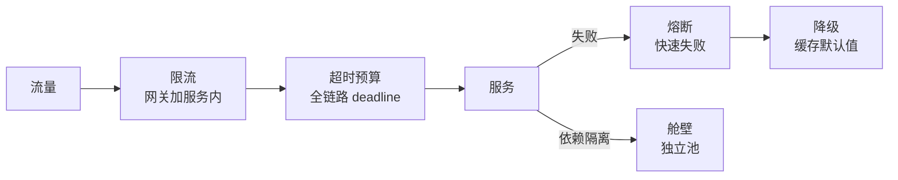

# 系统设计笔记

**摘要：** 通用解法框架（目标 → 澄清 → 总体 → 深挖 → 兜底）+ 分层弹药（微服务/并发/稳定性/存储/检索/可观测）+ 完整案例（10 万写入、KV 存储、支付防重、线上排障）。与《存储笔记》分工：本篇讲"怎么设计系统"，存储细节回存储篇。

**怎么读：** §0 框架是口述顺序，§1–§5 是弹药库（按题型查），§6 是完整走一遍的案例。标"常问"的是高频口述点。

## 0. 通用解法框架

**一句话：先定目标，再问约束，然后画链路，挑一点深挖，最后补兜底——顺序即评分点。**

- **目标五维：** 性能（P50/P95/P99、QPS、错误率）→ 伸缩（无状态 + 扩缩容，分片/读写分离）→ 扩展（边界分层、IDL 契约、版本化）→ 可用（超时/重试/熔断/降级/限流/隔离）→ 安全（鉴权最小化、审计、加密）。
- **澄清清单（必问）：** 规模（QPS/数据量/读写比）→ 语义（顺序/一致性/可丢否）→ 约束（延迟目标、成本、合规）→ 失败语义（全回滚/本批回滚/跳过可查）→ 线上影响（隔离/窗口/限速）。
- **口述顺序：** 总体链路（一句话）→ 流量怎么走 → 数据怎么存 → 失败怎么办 → 指标怎么看。先给结论再展开，数字给量级不给精确值。

## 1. 微服务、RPC 与负载均衡

**一句话：调用链路是"IDL → 连接 → 服务发现 → 负载均衡"，哪个环节抖，P99 就用到哪个环节。**

- **RPC 调用链：** IDL 生成 Stub → 序列化 → 连接池/长连接/多路复用 → 发请求 → 反序列化 → 执行业务。选 IP = 服务发现（注册中心给实例列表）+ 负载均衡（客户端 SDK 选或网关/Nginx/Envoy 选）。
- **负载均衡算法（常问）：** 轮询/加权（同质实例）、随机（实现轻）、最少连接（连接时长差异大）、EWMA 动态（按延迟错误率）、一致性哈希/Rendezvous（会话粘性、本地缓存）、P2C（随机挑二比一，低成本效果好）。
- **一致性哈希：** 环 + 虚拟节点（均匀 + 少迁移）+ 有序结构 + 副本因子。轮询/随机的毛病：不感知负载、异构不友好、缓存命中差、故障收敛慢。
- **Nginx 超时：** 先定位哪段（client→Nginx 还是 upstream），盲目调大超时放大排队；根因是慢接口/下游，加缓存异步化、拆大请求、keepalive；配摘除 + 熔断限流。
- **Nginx 生命周期：** master 读配置 fork worker；worker epoll 事件循环；reload 起新 worker 平滑退旧。
- **网关能力：** 鉴权、路由、限流、重试、熔断、协议转换、观测审计；无状态可扩展，配置热更新。

## 2. 并发与稳定性治理

**一句话：正确性用幂等 + 状态机兜底，可用性用超时/重试/熔断/降级/隔离五件套——先保命，再保快。**

- **防重（常问）：** 幂等 key 贯穿全链路 + DB 唯一约束/防重表 + 状态机条件更新（`where status=INIT`）+ Redis 布隆预拦截。支付防重即此：发起端重试保"至少一次"，状态端条件更新保"最多一次"，流水表唯一约束防重复入账，回调幂等，对账补偿。
- **分布式锁：** `SET NX PX` + token + Lua 解锁 + TTL 续租；提到百万 QPS：先替代锁（幂等/条件更新/去重表），再拆粒度（lock striping/热点拆分），再减次数（singleflight/批处理），最后提锁服务（分片/pipeline/就近路由）。
- **无锁扛并发：** 幂等化 + 乐观并发（版本号/CAS/条件更新）+ 按 key 分区串行（Kafka 分区/Actor）+ 缓存 + singleflight 防放大 + 号段预发。
- **超时与重试：** 全链路 deadline 逐跳扣减；只对幂等操作重试，退避 + 抖动 + 上限；队列必须有界（最大长度 + 最大等待）。
- **线程池（常问）：** 任务队列 + worker + core/max + 拒绝策略 + keepAlive。提交：core 不满建线程 → 入队 → 队满且未达 max 建线程 → 拒绝。关闭：graceful（排空）vs 立刻丢弃。

## 3. 存储、缓存与一致性

**一句话：缓存管快慢、DB 管对错、MQ 管削峰——一致性按"Cache-Aside + 兜底"和"Saga + 补偿"两套话术答。**

- **缓存系统设计：** 命中率、穿透/击穿/雪崩、热点/大 key、淘汰、监控。策略：Cache-Aside 为主，写后删缓存（延迟双删）、异步更新、逻辑过期。热点：本地缓存、请求合并、分片 key；大 key：拆分分页。
- **订单/库存扣减（常问）：** 乐观锁/条件更新、预扣 + 超时回滚、分区串行；一致性靠补偿对账，不优先分布式事务。
- **分布式事务选型：** 2PC 强一致但阻塞；Saga 一串本地事务 + 补偿（最常用）；TCC 性能好但侵入强。Outbox：业务与消息同库写，异步投递 + 幂等消费。
- **全局唯一 ID：** Snowflake（时间 + 机房 + 机器 + 序列，防时钟回拨）/ 号段批量分配 / UUID（无序伤索引）。
- **短链/文件存储：** base62 + 冲突处理 + 缓存回源 + 风控统计；分片上传、断点续传、预签名 URL、CDN、元数据生命周期。
- **Raft 三件事：** 选主、日志复制、安全性（term/index 约束不回滚已提交）。CAP 只能取二，BASE 是工程答案。
- **7 种分布式模式（清单）：** 大使、熔断器、事件溯源、领导者选举、发布订阅、CQRS、分片。

## 4. 检索、推荐与计数

**一句话：搜索是倒排 + 召回融合，Feed 是推拉权衡，计数是异步聚合——三处都接受短时不一致、对账纠偏。**

- **搜索：** 倒排索引 + 分片副本 + 增量重建；排序 = 相关性 + 业务特征，多路召回融合。
- **推荐/Feed：** 写扩散 vs 读扩散，冷热分层，去重与已读游标；高并发靠分区队列 + 缓存 + 分页游标。
- **点赞/评论/计数：** 写日志异步聚合，读写分离，热点分桶；短时不一致可接受。
- **秒杀/预约：** 预热排队、令牌资格校验、限流降级；库存原子扣减 + 幂等 + 防刷。
- **通知：** 渠道编排、重试退避、限频；messageId 去重 + 投递状态机。

## 5. 可观测、配置与任务

**一句话：指标看 RED/USE，日志要结构化 + 链路 ID，追踪靠采样；配置与发布走灰度 + 开关 + 回滚。**

- **监控告警：** RED（Rate/Errors/Duration）+ USE（利用率/饱和度/错误）；多维聚合、抑制去重、分级自愈，防告警风暴。
- **日志/追踪：** 结构化、采样脱敏、冷热分层；traceId/spanId 联动指标定位 P99；头部/尾部采样控成本。
- **容量与压测：** SLO + 峰值因子建模；影子流量/录制回放；压测隔离与安全开关。
- **配置中心：** 推/拉 + 版本号 + 灰度回滚；本地落盘降级；敏感配置加密审计。
- **特性开关：** 按用户/城市/机房/比例路由；紧急熔断；治理"永久开关"堆积。
- **灰度发布：** 金丝雀/分批/标签路由；自动回滚 + 健康门禁；盯错误率与 P99。
- **延迟/调度/对账：** 时间轮/延迟队列/DB 扫，分片 + 故障转移；至少一次 + 幂等；对账重放纠偏、checkpoint、血缘审计。

## 6. 完整案例

**一句话：案例按§0 框架走三遍——10 万写入（导入）、KV 存储（设计）、线上排障（运维）。**

### 6.1 10 万条入库（常问模板）

- **澄清：** 一次性还是持续？行大小？指标（rows/s/P99）？全量成功还是部分可补？要顺序/写后读否？同步等还是异步任务？什么库什么拓扑？影响线上否？
- **思路：** 能异步就异步（任务 + taskId 查进度），能批量就批量（500–2000 行/批，每批一事务），能幂等就幂等（upsert/ignore + 幂等键），能隔离就隔离（独立池/实例/限速）。
- **失败与可观测：** 重试退避 + 上限/跳过记表/终止策略二选一；失败表明细可查；盯吞吐/批耗时/失败率/连接池/队列堆积。
- **一句话：** 批量 + 合理事务 + 受控并发解决快；异步 + 幂等 + 进度可追踪解决稳。

### 6.2 分布式 KV 存储

- 澄清读写比/量级/QPS/延迟/Scan/TTL/一致性；单机 LSM（WAL + MemTable + SSTable + 布隆 + Compaction）或 B+Tree；分片（一致性哈希/范围）+ 在线迁移限速；复制（多副本/quorum R+W>N）；热点拆分 + 本地缓存；延迟/放大/compaction 指标。
- Follow 变体：`user:{uid}:meta/following/followers`，大列表分段 + 游标；双写走事件 + 重试 + 幂等做最终一致；计数异步聚合；限流去重防刷。
- 线程安全 LRU：HashMap + 双向链表；单锁最简单，高并发分段；RWLock 收益有限（Get 也要写）。

### 6.3 线上排障两题

- **502：** 定来源（CDN/LB/Nginx/网关/应用）→ 看 upstream 错误（connect/read 超时/RST）→ 看上游（实例/CPU/GC/池队列/慢 SQL）→ 止血（摘除/回滚/降级限流）。
- **变慢：** 观测分层（入口/依赖/CPU/GC/池）→ 找变化点（发布/流量/数据/依赖）→ 限流降级/扩容/热点隔离/修慢 SQL。
- **第三方高并发 API：** 签名鉴权风控、租户限流隔离、幂等重试熔断、日志指标灰度回滚。

### 6.4 大文件分发（AI infra 味）

- 500GB 模型分发到数百节点、外网带宽受限：P2P/BitTorrent 分块互传或树状分发，用足内网横向带宽，消灭单点。

## 附：与他篇的边界

- 缓存三问题与淘汰策略、MQ 可靠性四问 → 《存储笔记》。
- GMP/线程池（Go/Java 各自实现）→ 《Go笔记》《Java/Python笔记》。
- 手撕代码清单（LRU/括号/撮合）本次不入篇，复习时按清单刷。
