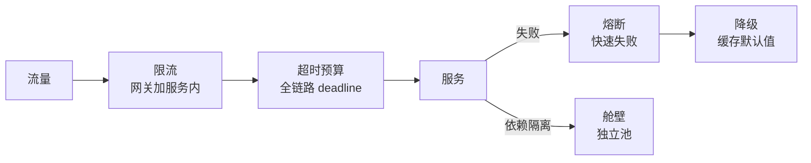

# 系统设计笔记

**摘要：** §0 基础知识（指标、原则、分布式考量、系统风格）+ §1–§5 分层弹药（每章先讲知识、末尾给一个完整案例）+ §6 大案例（C 端大模型 GPU 调度打头）。与《存储笔记》分工：本篇讲"怎么设计系统"，存储细节回存储篇。参考：donnemartin/system-design-primer（指标与权衡框架）。

**怎么读：** 先读§0 建立"目标—约束—权衡"三板斧；§1–§5 按题型查（知识 + 案例对照看）；§6 完整走一遍。标"常问"的是高频口述点。

## 0. 基础知识

**一句话：指标定目标，原则定取舍，分布式考量定约束，系统风格定形状——四样齐了再画图。**

### 0.1 常见系统指标（常问）

- **性能：** QPS/并发、延迟 P50/P95/P99（只报 P99 不报平均）、错误率、吞吐（rows/s、msgs/s）。
- **可用：** SLA（99.9% 年停机 ~9h、99.99% ~53min）、MTTR、故障演练覆盖率。
- **资源：** CPU/内存/IO 利用率、饱和度（队列/连接池/堆积 lag）、成本（单请求成本、机器数）。
- **估算：** 2 的次方速算（10QPS→日 ~86 万请求）、延迟量级表（见《基础笔记》§5，先定量级再压测）。

### 0.2 设计原则

- **简单优先：** 能单体不微服务，能同步不同步，能读主不读写分离——复杂度是负债。
- **演进设计：** 按当前量级做够，留扩展点（分片键、版本号、开关），不做超前设计。
- **处处权衡：** 一致性换可用、延迟换吞吐、成本换体验——每个决策说出代价。
- **故障常态：** 超时、重试、熔断、降级、隔离是默认配置，不是选配。
- **可观测先行：** 指标、日志、追踪随第一版上线，不然后面全是黑盒。
- **无状态服务：** 状态下沉到 DB/缓存/对象存储，服务本身可随意扩缩。

### 0.3 分布式考量

- **CAP：** 分区必选，一致性和可用性二选一；CP（zk/Raft/强一致存储）vs AP（DNS/缓存/注册中心）。BASE 是 AP 的工程答案。
- **一致性模型：** 强一致（同步复制，读写贵）→ 最终一致（异步复制，读写便宜）→ 弱一致（读到什么算什么）。按业务选，不按喜好选。
- **复制：** 主从（读写分离，延迟读旧）vs 主主（双写冲突要解）；副本数、quorum（R+W>N）、联合（按功能拆库）、分片（按 key 拆，热点是永恒敌人）、反规范化（读多写少时冗余换联结）。
- **SQL vs NoSQL 选型：** 结构化 + 事务 + 复杂联结 → SQL；半结构 + 海量 + 高吞吐 → NoSQL（KV/文档/宽列/图按访问模式再选）。
- **时钟与顺序：** 分布式无全局钟，顺序靠序列号/版本号/逻辑钟；跨机排序是坑，能避则避。

### 0.4 系统风格

- **单体/分层：** 小团队小流量最优解，别为微服务而微服务。
- **微服务：** 按领域/数据边界拆，配服务发现、配置中心、治理三件套；代价是运维与排查复杂度。
- **事件驱动：** 事件总线 + CQRS（读写分离）+ Event Sourcing（事件即真相）；解耦强、调试难，配好追踪与重放。
- **批流一体：** 离线批（吞吐）+ 实时流（延迟）+ 对账层；Lambda 笨重、Kappa 统一，看团队体量选。
- **缓存/CDN/异步三板斧：** 读多加缓存，慢操作异步化，静态下沉 CDN——三招解决八成性能题。

### 0.5 口述顺序

总体链路（一句话）→ 流量怎么走 → 数据怎么存 → 失败怎么办 → 指标怎么看。先给结论再展开，数字给量级不给精确值；澄清清单：规模、语义、约束、失败语义、线上影响（先问再答，见框架图）。

## 1. 微服务、RPC 与负载均衡

**一句话：调用链路是"IDL → 连接 → 服务发现 → 负载均衡"，哪个环节抖，P99 就抖到哪个环节。**

- **RPC 调用链：** IDL 生成 Stub → 序列化 → 连接池/长连接/多路复用 → 发请求 → 反序列化 → 执行业务。选 IP = 服务发现（注册中心给实例列表）+ 负载均衡（客户端 SDK 选或网关/Nginx/Envoy 选）。
- **负载均衡算法（常问）：** 轮询/加权（同质实例）、随机（实现轻）、最少连接（连接时长差异大）、EWMA 动态（按延迟错误率）、一致性哈希/Rendezvous（会话粘性、本地缓存）、P2C（随机挑二比一，低成本效果好）。
- **一致性哈希：** 环 + 虚拟节点（均匀 + 少迁移）+ 有序结构 + 副本因子。轮询/随机的毛病：不感知负载、异构不友好、缓存命中差、故障收敛慢。
- **Nginx 超时：** 先定位哪段（client→Nginx 还是 upstream），盲目调大超时放大排队；根因是慢接口/下游，加缓存异步化、拆大请求、keepalive；配摘除 + 熔断限流。
- **网关能力：** 鉴权、路由、限流、重试、熔断、协议转换、观测审计；无状态可扩展，配置热更新。

**案例：七层网关 + P2C（知识落地）**

- 场景：百服务实例异构（新老机器混布），P99 被慢实例拖垮。
- 设计：网关 L7 按 URL/租户路由 → 服务内 P2C 选实例（随机两台比 EWMA 延迟）→ 不健康实例按错误率摘除 → 超时预算逐跳扣减。
- 为什么：轮询不感知负载（慢实例照收流量），P2C 用两次随机达到近似最优，成本远低于全局最优解；摘除 + 预算保证坏实例快速出局。

## 2. 并发与稳定性治理

**一句话：正确性用幂等 + 状态机兜底，可用性用超时/重试/熔断/降级/隔离五件套——先保命，再保快。**

- **防重（常问）：** 幂等 key 贯穿全链路 + DB 唯一约束/防重表 + 状态机条件更新（`where status=INIT`）+ Redis 布隆预拦截。
- **分布式锁：** `SET NX PX` + token + Lua 解锁 + TTL 续租；提到百万 QPS：先替代锁（幂等/条件更新/去重表），再拆粒度（lock striping/热点拆分），再减次数（singleflight/批处理），最后提锁服务（分片/pipeline/就近路由）。
- **无锁扛并发：** 幂等化 + 乐观并发（版本号/CAS/条件更新）+ 按 key 分区串行（Kafka 分区/Actor）+ 缓存 + singleflight 防放大 + 号段预发。
- **超时与重试：** 全链路 deadline 逐跳扣减；只对幂等操作重试，退避 + 抖动 + 上限；队列必须有界（最大长度 + 最大等待）。
- **线程池（常问）：** 任务队列 + worker + core/max + 拒绝策略 + keepAlive。提交：core 不满建线程 → 入队 → 队满且未达 max 建线程 → 拒绝。关闭：graceful（排空）vs 立刻丢弃。

**案例：订单系统（知识落地）**

- 场景：下单扣减库存，高并发下不错卖、不超卖、可对账。
- 设计：下单链（幂等 orderNo → 库存条件更新扣减 → Outbox 写流水 → MQ 异步履约）→ 支付（发起端重试保至少一次，状态机 `UNPAID→PAID` 保最多一次，流水唯一约束防重复入账）→ 对账补偿（定时扫差异 + 重放）。
- 分片：订单按 user/order 号 hash 分片，热点 SKU 拆分 + 本地缓存 + 限流；读走从库/缓存，写走主库。
- 为什么：正确性不靠锁靠"幂等 + 状态机 + 唯一约束"三件套（锁只保临界区，不保全链路）；性能靠分片 + 异步 + 缓存三件套。

## 3. 存储、缓存与一致性

**一句话：缓存管快慢、DB 管对错、MQ 管削峰——一致性按"Cache-Aside + 兜底"和"Saga + 补偿"两套话术答。**

- **缓存系统设计：** 命中率、穿透/击穿/雪崩、热点/大 key、淘汰、监控。策略：Cache-Aside 为主，写后删缓存（延迟双删）、异步更新、逻辑过期。
- **分布式事务选型：** 2PC 强一致但阻塞；Saga 一串本地事务 + 补偿（最常用）；TCC 性能好但侵入强。Outbox：业务与消息同库写，异步投递 + 幂等消费。
- **全局唯一 ID：** Snowflake（时间 + 机房 + 机器 + 序列，防时钟回拨）/ 号段批量分配 / UUID（无序伤索引）。
- **短链/文件存储：** base62 + 冲突处理 + 缓存回源 + 风控统计；分片上传、断点续传、预签名 URL、CDN、元数据生命周期。
- **Raft 三件事：** 选主、日志复制、安全性（term/index 约束不回滚已提交）。CAP 只能取二，BASE 是工程答案。
- **7 种分布式模式（清单）：** 大使、熔断器、事件溯源、领导者选举、发布订阅、CQRS、分片。

**案例：nacos 服务发现的一致性（知识落地）**

- 场景：注册中心要"永远可查"，短暂不一致可接受——天然 AP。
- 设计：临时实例走 Distro 协议（AP，最终一致，心跳续约）；持久化配置走 Raft（CP，强一致）。健康检查摘除坏实例，客户端缓存 + 定时拉全量兜底。
- 为什么：注册发现读多写少、容忍秒级延迟，AP 换可用；配置下发要"读到即最新"，CP 保正确。同一系统两种一致性按数据类型拆分——这是"按业务选一致性"的标准答案。

## 4. 检索、推荐与计数

**一句话：搜索是倒排 + 召回融合，Feed 是推拉权衡，计数是异步聚合——三处都接受短时不一致、对账纠偏。**

- **搜索：** 倒排索引 + 分片副本 + 增量重建；排序 = 相关性 + 业务特征，多路召回融合。
- **计数：** 写日志异步聚合，读写分离，热点分桶；短时不一致可接受。
- **秒杀/预约：** 预热排队、令牌资格校验、限流降级；库存原子扣减 + 幂等 + 防刷。
- **通知：** 渠道编排、重试退避、限频；messageId 去重 + 投递状态机。

**案例：推荐 Feed 流（知识落地）**

- 场景：千万用户刷信息流，读写都大，允许秒级延迟。
- 设计：召回（多路：画像/热门/协同过滤融合排序）→ 写扩散 vs 读扩散按粉调（大 V 写扩散存料，普通用户读扩散现场拉）→ Feed 队列分区 + 缓存 + 游标分页 → 去重与已读过滤。
- 为什么：推拉本质是"写放大换读性能"的权衡；冷热分层（热用户料预热、冷用户现场算）控成本；游标分页避深度翻页的性能坑。

## 5. 可观测、配置与任务

**一句话：指标看 RED/USE，日志要结构化 + 链路 ID，追踪靠采样；配置与发布走灰度 + 开关 + 回滚。**

- **监控告警：** RED（Rate/Errors/Duration）+ USE（利用率/饱和度/错误）；多维聚合、抑制去重、分级自愈，防告警风暴。
- **日志/追踪：** 结构化、采样脱敏、冷热分层；traceId/spanId 联动指标定位 P99；头部/尾部采样控成本。
- **容量与压测：** SLO + 峰值因子建模；影子流量/录制回放；压测隔离与安全开关。
- **配置中心：** 推/拉 + 版本号 + 灰度回滚；本地落盘降级；敏感配置加密审计。
- **特性开关：** 按用户/城市/机房/比例路由；紧急熔断；治理"永久开关"堆积。
- **灰度发布：** 金丝雀/分批/标签路由；自动回滚 + 健康门禁；盯错误率与 P99。
- **延迟/调度/对账：** 时间轮/延迟队列/DB 扫，分片 + 故障转移；至少一次 + 幂等；对账重放纠偏、checkpoint、血缘审计。

**案例：Agent 可观测（知识落地）**

- 场景：Agent 循环（推理 → 工具 → 观测 → 再推理）黑盒化，失败不知卡在哪一环。
- 设计：traceId 贯穿整轮（span 按"推理/工具调用/检索/验证"打点）→ 指标：token 用量与费用、端到端延迟分解、各工具成功率、验证通过率 → 失败归因：轨迹归类（缺稳定元认知环是共性缺口，见《RSI 笔记》§3.3 的 45 类失败归因思路）→ 评估集回归（改 Harness 前后同题重跑）。
- 为什么：Agent 的可观测 = 传统三件套 + "token 经济学" + "轨迹归因"；没有轨迹分级，优化就是盲调。

## 6. 大案例

**一句话：本节把§0–§5 穿起来——先看 C 端大模型 GPU 调度（覆盖存储三件套），再看三个经典题。**

### 6.1 C 端大模型服务与 GPU 调度（覆盖 MySQL/Redis/MQ）

- **场景：** C 端用户发请求 → 调度 GPU 推理 → 流式回 token；GPU 贵且有限，高峰排队、低谷闲置，还要按量计费。
- **链路：** 网关鉴权限流 → 会话与上下文进 Redis（TTL + 配额计数）→ 请求入 MQ 排队（优先级队列：付费/普通分级）→ 调度器选卡（装箱：显存碎片整理、多租户隔离、防抖动抢占）→ 推理服务流式输出（SSE/WebSocket，首 token 延迟是核心指标）→ 结果落 MySQL（账单 + 用量）→ 异步对账计费。
- **三件套分工：** Redis 管会话/配额/限流计数（快）；MQ 管削峰排队 + 优先级（异步）；MySQL 管账单用量（可靠 + 对账）。上下文窗口超限做摘要压缩，降 token 成本。
- **兜底：** 排队超时降级（排队位 + 预计等待）、过载熔断（503 + 稍后重试）、按租户隔离（付费不受免费挤占）、token 用量实时 metering（超额停服不断连：先警告后降级）。
- **为什么：** 这是"存储三件套 + 调度 + 流式 + 计费"的综合体；答出"排队、装箱、隔离、 metering"四词即过关。

### 6.2 10 万条入库（常问模板）

- **澄清：** 一次性还是持续？行大小？指标（rows/s/P99）？全量成功还是部分可补？要顺序/写后读否？同步等还是异步任务？什么库什么拓扑？影响线上否？
- **思路：** 能异步就异步（任务 + taskId 查进度），能批量就批量（500–2000 行/批，每批一事务），能幂等就幂等（upsert/ignore + 幂等键），能隔离就隔离（独立池/实例/限速）。
- **失败与可观测：** 重试退避 + 上限/跳过记表/终止策略二选一；失败表明细可查；盯吞吐/批耗时/失败率/连接池/队列堆积。
- **一句话：** 批量 + 合理事务 + 受控并发解决快；异步 + 幂等 + 进度可追踪解决稳。

### 6.3 分布式 KV 存储

- 澄清读写比/量级/QPS/延迟/Scan/TTL/一致性；单机 LSM（WAL + MemTable + SSTable + 布隆 + Compaction）或 B+Tree；分片（一致性哈希/范围）+ 在线迁移限速；复制（多副本/quorum R+W>N）；热点拆分 + 本地缓存；延迟/放大/compaction 指标。
- Follow 变体：`user:{uid}:meta/following/followers`，大列表分段 + 游标；双写走事件 + 重试 + 幂等做最终一致；计数异步聚合；限流去重防刷。
- 线程安全 LRU：HashMap + 双向链表；单锁最简单，高并发分段；RWLock 收益有限（Get 也要写）。

### 6.4 线上排障两题

- **502：** 定来源（CDN/LB/Nginx/网关/应用）→ 看 upstream 错误（connect/read 超时/RST）→ 看上游（实例/CPU/GC/池队列/慢 SQL）→ 止血（摘除/回滚/降级限流）。
- **变慢：** 观测分层（入口/依赖/CPU/GC/池）→ 找变化点（发布/流量/数据/依赖）→ 限流降级/扩容/热点隔离/修慢 SQL。
- **第三方高并发 API：** 签名鉴权风控、租户限流隔离、幂等重试熔断、日志指标灰度回滚。

### 6.5 大文件分发（AI infra 味）

- 500GB 模型分发到数百节点、外网带宽受限：P2P/BitTorrent 分块互传或树状分发，用足内网横向带宽，消灭单点。

## 附：常见题型覆盖与边界

- **覆盖：** RPC 框架（§1）、秒杀（§4）、MQ 设计（§3 + 《存储笔记》§3）、线程池/HashMap（§2 + 语言篇）、短链/ID 发号器/文件上传（§3）、订单超时取消（延迟队列/时间轮 §5）、点赞/评论（§4）、接口计数（令牌桶 §2）、IM 历史分页（游标 §4）、购物车（状态机 + 缓存 §2）、数仓同步（Outbox + 对账 §5）。
- **边界：** GMP/线程池的语言实现 → 《Go笔记》《Java/Python笔记》；缓存三问题、MQ 可靠性四问 → 《存储笔记》；手撕代码清单本次不入篇，按清单刷。

参考：donnemartin/system-design-primer（指标、权衡、C4 风格与经典题型）。
